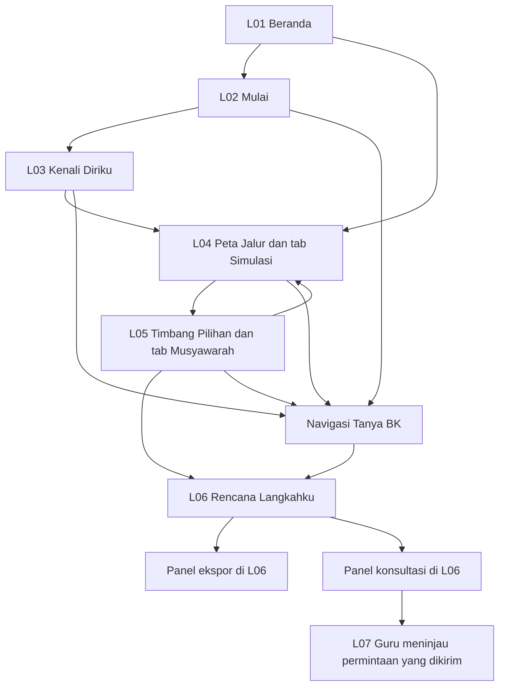
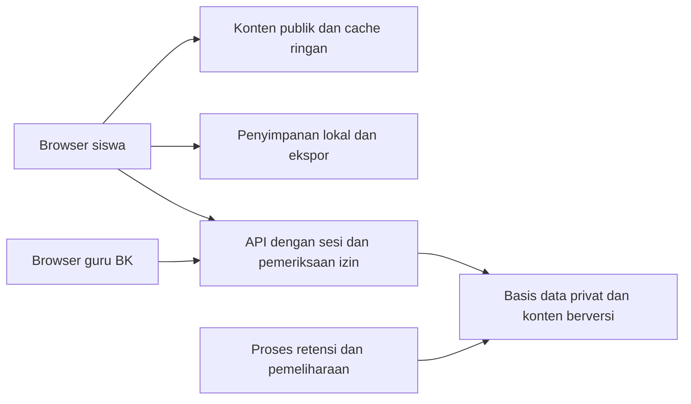

# PRD PILIHANKU

**Product Requirements Document - Website Eksplorasi Karier Siswa SMA XI-XII**

| Metadata         | Keterangan                                                                                                              |
| ---------------- | ----------------------------------------------------------------------------------------------------------------------- |
| Versi            | 1.1 - struktur ringkas 8 layar utama                                                                                    |
| Tanggal          | 21 November 2026                                                                                                        |
| Status           | Rancangan pembangunan berdasarkan proposal; keputusan yang memerlukan validasi dicatat pada Bagian 21                   |
| Sumber utama     | `UTS_TeknologiBK_PutriAgny_PILIHANKU.docx.pdf`, proposal Putri Agny, 2026                                               |
| Bentuk produk    | Website responsif dengan empat langkah eksplorasi dan layanan penghubung ke guru BK                                     |
| Sasaran rilis    | Prototipe lengkap untuk demonstrasi dan uji terbatas; penggunaan data siswa nyata melalui kesiapan operasional terpisah |
| Bahasa antarmuka | Bahasa Indonesia                                                                                                        |
| Acuan desain     | [design.md](./design.md), versi 1.1; 8 layar utama dan 4 kelompok prompt UI                                             |

## 1. Cara membaca dokumen dan dasar penyusunan

Dokumen ini menganalisis proposal lalu menerjemahkannya menjadi kebutuhan produk, perilaku fitur, rancangan halaman, aturan data, arsitektur, dan kriteria penerimaan yang dapat digunakan desainer, pengembang, guru BK, serta penguji. Pembuatan website merupakan tahap berikutnya; dokumen ini tidak menyatakan bahwa website sudah dibangun atau diuji.

**Revisi 1.1:** pembangunan menggunakan **8 layar utama**, terdiri dari enam layar siswa dan dua layar guru. Hasil refleksi, detail jalur, simulasi, musyawarah, ekspor, konsultasi, pengaturan, dan masuk guru ditempatkan sebagai tab, panel, atau keadaan pada layar induk. Jumlah fitur bukan jumlah halaman. Struktur ini mengikuti penyederhanaan yang diminta pengguna dan menjadi acuan implementasi bersama `design.md`.

Penanda asal kebutuhan:

- **[P] Proposal:** ketentuan yang dinyatakan dalam proposal.
- **[D] Desain:** keputusan atau usulan operasional dalam PRD untuk melengkapi detail yang belum ditentukan proposal.
- **[V] Validasi:** hal yang masih harus ditetapkan bersama pemilik produk, sekolah, atau ahli sebelum digunakan pada siswa nyata.

Seluruh rincian teknis yang tidak secara eksplisit dipetakan ke proposal merupakan **[D]**, termasuk rute halaman, kontrak API, skema data, batas input, dan mekanisme autentikasi. Angka target yang berasal dari proposal diberi keterangan [P].

Nomor halaman sumber di dokumen ini menggunakan **urutan halaman PDF, dimulai dari 1**, bukan nomor cetak di bawah halaman. PDF memiliki 44 halaman: halaman 1 adalah sampul laporan pemeriksaan kemiripan; halaman 2-41 memuat proposal dan lampiran; halaman 42-44 memuat laporan kemiripan. Persentase kemiripan bukan bukti kelayakan atau efektivitas produk. Penanda sorotan kemiripan bukan bagian dari persyaratan website.

Proposal diperlakukan sebagai bahan analisis. Petunjuk kepada responden angket, skenario uji, dan aktivitas penelitian di dalamnya diterjemahkan menjadi kebutuhan yang relevan, bukan perintah untuk menjalankan penelitian atau menghubungi pihak lain sekarang.

## 2. Analisis proposal

### 2.1 Masalah yang ingin diselesaikan

**[P]** Siswa kelas XI-XII perlu memilih arah setelah SMA, tetapi masih mengalami kebimbangan, belum menghubungkan minat dan kondisi diri dengan pilihan, serta kesulitan membandingkan informasi studi dan kerja. Guru BK memiliki waktu layanan terbatas dan membutuhkan gambaran kebutuhan kelas. Sumber: PDF hlm. 3, 8-12.

Prioritas masalah pengguna:

1. Mengenali minat, nilai pribadi, kekuatan, dukungan, dan hambatan.
2. Memahami empat kelompok jalur secara setara: kuliah, vokasi/kedinasan, kerja/pelatihan, dan wirausaha.
3. Membandingkan alternatif dengan pertimbangan pribadi yang dapat dijelaskan.
4. Mengubah pertimbangan menjadi langkah yang dapat dilakukan.
5. Menyiapkan bahan diskusi keluarga dan konsultasi guru BK.

Website perlu menjadi **ruang kerja eksplorasi**, bukan hanya halaman profil sekolah atau katalog jurusan. Fitur harus saling terhubung dari refleksi sampai rencana tindakan.

### 2.2 Kekuatan rancangan proposal

| Kekuatan                                    | Implikasi bagi pembangunan                                                          |
| ------------------------------------------- | ----------------------------------------------------------------------------------- |
| Empat langkah eksplorasi sudah jelas        | Gunakan sebagai navigasi dan struktur informasi utama                               |
| Pilihan studi dan kerja ditempatkan setara  | Tidak menempatkan kuliah sebagai hasil yang dianggap lebih baik                     |
| Ada teori yang mendasari fitur              | Setiap interaksi harus memiliki manfaat bagi proses eksplorasi                      |
| Ada simulasi dan matriks berbobot           | Website harus mendukung interaksi dan perhitungan, bukan hanya artikel              |
| Ada batas otomatisasi dan perlindungan data | Pembatasan akses dan bahasa hasil menjadi syarat penerimaan                         |
| Ada indikator uji terukur                   | Hasil pengembangan dapat ditinjau dengan checklist, validasi ahli, dan uji pengguna |

### 2.3 Kekosongan dan ketidaksinkronan yang perlu diselesaikan

| Temuan analisis                                                                | Penyelesaian dalam PRD                                                                                                        |
| ------------------------------------------------------------------------------ | ----------------------------------------------------------------------------------------------------------------------------- |
| Kode kelas dan nama panggilan belum menjelaskan bukti kepemilikan data         | Kode kelas untuk bergabung; akses data pribadi memakai kredensial rahasia terpisah, lihat Bagian 6                            |
| Mode Tamu belum menjelaskan cara mengirim dan memantau konsultasi              | Eksplorasi tetap lokal; pengiriman membutuhkan tujuan kelas/guru dan token permintaan, lihat Bagian 10.8                      |
| Tanya Guru BK berlabel minimum, tetapi Ruang Guru BK berlabel lanjutan         | Bangun kotak masuk guru sederhana pada tahap I agar pengiriman dapat diuji; dasbor agregat dan CMS tetap tahap II             |
| Lampiran uji meminta tamu mengajukan konsultasi                                | Tamu boleh melanjutkan ke pengiriman setelah memilih tujuan dan menyetujui data minimum; bukan otomatis menjadi anggota kelas |
| Formula, penanganan skor seri, dan jawaban belum lengkap belum dirinci         | Tetapkan algoritma transparan dan kasus batas, lihat Bagian 11                                                                |
| Belum ada naskah lengkap 24 butir minat dan lima pohon skenario                | Masukkan sebagai pekerjaan konten dan validasi ahli, bukan dianggap sudah tersedia                                            |
| Tidak ada aturan sinkronisasi, konflik data, dan perangkat bersama             | Tetapkan sumber data, pengamanan sesi, serta pilihan hapus dan penyimpanan lokal                                              |
| Tidak ada rincian status konsultasi dan siapa penanggung jawab                 | Tetapkan alur status dengan keputusan jadwal oleh guru BK                                                                     |
| Target sekitar 40 kartu belum disertai pembagian dan mekanisme penerbitan      | Target implementasi 40 kartu terverifikasi, alokasi awal seimbang dan dapat direvisi                                          |
| Dukungan pemasangan layar utama belum menjelaskan kemampuan luring             | Pisahkan instalasi, cache konten publik, penyimpanan lokal, dan operasi yang membutuhkan internet                             |
| Pemisahan setiap fungsi menjadi halaman membuat rancangan terlalu banyak layar | Batasi menjadi 8 layout utama dengan tab/panel; pertahankan fungsi, akses langsung, dan batas privasi                         |

### 2.4 Batas kekuatan bukti

**[P]** Kebutuhan awal bersumber dari kajian dokumen, bukan survei lapangan yang telah selesai. Persona masih simulasi. Uji 6-10 siswa dimaksudkan untuk kelayakan dan keterpakaian, bukan membuktikan peningkatan kematangan atau keberhasilan karier. Sumber: PDF hlm. 10, 21-22, 29-31.

PRD tidak mengulang angka latar belakang sebagai fakta terkini yang telah diverifikasi. Keputusan konten seleksi, biaya, jadwal, dan kebijakan harus didasarkan pada sumber resmi yang diperiksa ketika konten akan diterbitkan.

## 3. Visi, tujuan, dan prinsip produk

### 3.1 Visi

Membantu siswa SMA XI-XII mengenali diri, menjelajahi beberapa jalur setelah lulus, menimbang pilihan secara sadar, dan menyusun rencana langkah bersama dukungan keluarga serta guru BK.

### 3.2 Tujuan produk

| ID   | Tujuan                                                       | Bukti yang dapat diamati                                                    |
| ---- | ------------------------------------------------------------ | --------------------------------------------------------------------------- |
| G-01 | Siswa memahami kecenderungan minat dan nilai pribadinya      | Refleksi selesai dan siswa dapat menjelaskan hasil dengan bahasanya sendiri |
| G-02 | Siswa dapat mencari dan membandingkan alternatif studi/kerja | Menemukan kartu lintas kategori dan menyimpan 2-3 opsi                      |
| G-03 | Siswa memahami konsekuensi serta alternatif                  | Menyebutkan setidaknya satu alternatif setelah simulasi                     |
| G-04 | Siswa dapat menjelaskan alasan pertimbangan                  | Matriks berisi nilai, bobot, dan penilaian siswa                            |
| G-05 | Siswa memiliki rencana yang dapat dilakukan                  | Minimal tiga langkah, tenggat, dukungan, dan rencana cadangan               |
| G-06 | Guru BK dapat menindaklanjuti kebutuhan secara tertata       | Permintaan sampai kepada guru berwenang dan status dapat dilihat pengirim   |
| G-07 | Akses tetap ringan dan privasi terjaga                       | Mode Tamu, lembar cetak, pembatasan akses, dan penghapusan berjalan         |

### 3.3 Prinsip wajib

- **[P]** Hasil adalah bahan refleksi; tidak ada diagnosis, label permanen, peringkat siswa, atau rekomendasi jurusan/pekerjaan otomatis.
- **[P]** Keputusan tetap pada siswa melalui diskusi dengan keluarga dan pendampingan guru BK.
- **[P]** Keempat kelompok jalur disajikan setara. Tidak ada kategori yang diberi status lebih unggul.
- **[P]** Langkah dapat diulang, hasil dapat diubah, dan siswa boleh membuka langkah mana pun.
- **[P]** Data dikumpulkan secukupnya dan siswa menentukan bagian yang dibagikan.
- **[P]** Nilai ikhtiar, musyawarah, tawakal, dan pengingat istikharah disampaikan dengan menghormati keragaman latar siswa.
- **[D]** Refleksi keagamaan bersifat opsional; tidak meminta agama, menilai keimanan, atau memengaruhi skor.
- **[D]** Tidak ada hasil palsu: status tersimpan, terkirim, dan dijadwalkan hanya muncul setelah operasi terkait berhasil.

### 3.4 Hubungan teori dan pengalaman pengguna

| Landasan dalam proposal                | Penerapan produk                                                                                   |
| -------------------------------------- | -------------------------------------------------------------------------------------------------- |
| Perkembangan karier Super              | Pilihan bersifat sementara; tersedia revisi dan kembali menjelajah                                 |
| Holland/RIASEC                         | Refleksi enam minat dan penanda minat pada kartu, tanpa pembatasan akses jalur                     |
| SCCT dan efikasi pengambilan keputusan | Aktivitas mengenali diri, mencari informasi, membandingkan, membuat tujuan, dan mengatasi hambatan |
| Taksonomi kesulitan keputusan Gati     | Panduan proses, sumber informasi resmi, matriks, serta diskusi keluarga                            |
| Nilai BK Islam                         | Musyawarah, ikhtiar, dan refleksi opsional sebelum memutuskan                                      |
| Pendampingan praktisi                  | Permintaan konsultasi dan ringkasan yang ditinjau guru, bukan keputusan sistem                     |

Sumber: PDF hlm. 14-19.

## 4. Pengguna, konteks, dan kebutuhan

| Pengguna         | Konteks utama                                                     | Kebutuhan                                                                                      |
| ---------------- | ----------------------------------------------------------------- | ---------------------------------------------------------------------------------------------- |
| Siswa XI         | Mulai mengaitkan mapel pilihan dan arah setelah SMA               | Panduan singkat, refleksi sederhana, eksplorasi luas                                           |
| Siswa XII        | Menghadapi pilihan, biaya, seleksi, atau kebutuhan segera bekerja | Perbandingan realistis, alternatif, rencana dengan tenggat                                     |
| Guru BK          | Layanan banyak siswa, waktu klasikal terbatas                     | Konten tepercaya, agregat kelas, permintaan yang dapat ditindaklanjuti                         |
| Orang tua/wali   | Pendamping musyawarah                                             | Ringkasan yang sengaja dibagikan siswa dan lembar diskusi yang mudah dibaca                    |
| Pengelola teknis | Menjaga layanan dan akses                                         | Konfigurasi sekolah, akun guru, pencadangan, serta pemulihan tanpa akses rutin ke isi refleksi |

Persona ilustratif dari proposal: Rani kelas XI, Dimas kelas XII, dan Bu Lestari sebagai guru BK. Ketiganya belum mewakili hasil riset lapangan. Orang tua tidak memiliki akun atau akses otomatis pada rilis ini.

**[P]** Akses dari ponsel Android, tablet, laptop, dan komputer laboratorium. Satu langkah ditargetkan 10-15 menit, keseluruhan dalam 2-3 sesi. Durasi adalah panduan kegiatan, bukan batas waktu yang memaksa siswa.

## 5. Cakupan dan tahapan produk

### 5.1 Cakupan rilis lengkap

| ID    | Modul                                                              | Tahap                                      | Asal                 |
| ----- | ------------------------------------------------------------------ | ------------------------------------------ | -------------------- |
| FR-01 | Beranda, penjelasan penggunaan, persetujuan, Mode Tamu/mode kelas  | I                                          | [P] minimum          |
| FR-02 | Kenali Diriku: 24 butir, nilai, kekuatan, mapel, dukungan/hambatan | I                                          | [P] minimum          |
| FR-03 | Peta Jalur: kartu, detail, filter, pencarian, sumber               | I; perluasan konten II                     | [P] minimum          |
| FR-04 | Simulasi Bagaimana Jika, minimal lima skenario bercabang           | II                                         | [P] lanjutan         |
| FR-05 | Timbang Pilihan: 2-3 opsi dan lembar musyawarah                    | I                                          | [P] minimum          |
| FR-06 | Rencana Langkahku: utama/cadangan, langkah, tenggat, unduh         | II                                         | [P] lanjutan         |
| FR-07 | Tanya Guru BK: kirim permintaan dan pantau status                  | I                                          | [P] minimum          |
| FR-08 | Kotak masuk guru sederhana                                         | I                                          | [D] dependensi FR-07 |
| FR-09 | Dasbor agregat kelas dan pengelolaan bank informasi                | II                                         | [P] lanjutan         |
| FR-10 | Hapus data, retensi, pembatasan akses, penyimpanan sementara       | Bertahap; lengkap sebelum uji terintegrasi | [P] dan rincian [D]  |
| FR-11 | Pemasangan layar utama, halaman ringan, lembar kerja cetak         | II                                         | [P]                  |

Tahap I adalah prototipe minimum menurut proposal. **Rilis lengkap PRD mencakup tahap I dan II**, kemudian validasi serta revisi. Keamanan dasar dan persetujuan tidak boleh ditunda jika data telah dikirim ke server.

**[D] Batas antarmuka:** modul FR-01 sampai FR-11 diwujudkan melalui delapan layar L01-L08 pada Bagian 7. Tidak diperlukan layout utama terpisah untuk setiap modul, setiap status formulir, atau setiap variasi perangkat. Empat kelompok generasi UI pada `design.md` merupakan cara menyiapkan desain; hasilnya tetap harus diimplementasikan dan diuji sesuai PRD.

### 5.2 Di luar cakupan

- Tes psikologis baku, diagnosis, sertifikasi bakat, atau klaim validitas psikometrik.
- Pemilihan jurusan otomatis, pencocokan dengan persentase keberhasilan, atau peringkat siswa.
- Chatbot AI, percakapan konseling langsung, konseling krisis, dan deteksi risiko otomatis.
- Pendaftaran kampus/pekerjaan, transaksi, pembayaran, serta jaminan diterima atau memperoleh pekerjaan.
- Portal orang tua/wali kelas, jejaring sosial, komentar publik, dan unggahan berkas bebas.
- Basis data seluruh kampus/lowongan, pengambilan data otomatis dari situs lain, serta sinkronisasi sistem sekolah.
- Aplikasi native Android/iOS dan sinkronisasi antarperangkat tanpa autentikasi.
- Pengujian efektivitas jangka panjang terhadap keputusan atau hasil karier.

## 6. Mode penggunaan, identitas, dan hak akses

### 6.1 Mode Tamu

**[P]** Eksplorasi tanpa akun. **[D]** Semua jawaban, pilihan, matriks, dan rencana disimpan pada perangkat jika siswa mengaktifkan penyimpanan. Tidak mengirim isian refleksi atau pola minat ke server secara diam-diam.

- Pilihan awal: "Perangkat pribadi - simpan di perangkat ini" atau "Perangkat bersama - gunakan sesi ini saja".
- Pada perangkat bersama, gunakan penyimpanan sesi dan tampilkan tombol "Selesai dan hapus dari perangkat". Penutupan browser tidak boleh dijanjikan selalu membersihkan data pada semua konfigurasi browser.
- Siswa dapat mengekspor PDF dan melanjutkan di perangkat yang sama jika penyimpanan diaktifkan.
- Tidak ada janji pemulihan setelah data browser dihapus atau pindah perangkat.
- Agregat kelas tidak memasukkan tamu yang belum bergabung dan belum menyetujui kontribusi data.
- Permintaan konsultasi merupakan operasi terpisah dengan data minimum, tujuan yang jelas, dan persetujuan khusus.

### 6.2 Mode kelas

**[P]** Identitas tampilan menggunakan nama panggilan dan kode kelas. **[D]** Keduanya tidak cukup sebagai autentikasi.

Alur yang dirancang:

1. Guru membuat kelas beserta tahun ajaran dan tanggal akhir retensi.
2. Siswa memasukkan kode kelas aktif dan nama panggilan; nama panggilan tidak wajib unik.
3. Setelah persetujuan yang diperlukan terpenuhi, server membuat ID peserta acak dan kunci pemulihan sekali tampil.
4. Server membuat sesi melalui cookie `HttpOnly`, `Secure`, dan kebijakan `SameSite` yang sesuai. Kunci pemulihan disimpan dalam bentuk hash di server dan tidak dimasukkan ke URL.
5. Kode kelas hanya menentukan keanggotaan; tidak dapat digunakan untuk membaca data siswa lain.
6. Kunci pemulihan dapat dipakai untuk melanjutkan pada perangkat lain. Siswa menyimpannya sendiri; guru tidak dapat membuka refleksi hanya dengan mengetahui nama panggilan.
7. Jika kunci hilang dan tidak ada sesi aktif, tampilkan pilihan memulai baru. Pemulihan lebih lanjut harus memiliki prosedur verifikasi sekolah, tidak menggunakan tebakan nama panggilan.

**[V]** Mekanisme akses ini perlu diuji keterpahamannya. Jika sekolah memiliki sistem identitas yang sesuai, mekanisme dapat diganti tanpa mengubah batas akses dan prinsip minimisasi data.

### 6.3 Guru BK dan pengelola teknis

- Akun guru dibuat oleh pengelola yang ditunjuk; tidak ada pendaftaran guru terbuka.
- Guru masuk menggunakan kredensial akun; peran tidak bisa dipilih sendiri melalui UI.
- Guru hanya melihat kelas yang ditugaskan kepadanya, agregat yang aman, dan permintaan yang ditujukan kepadanya/kelasnya.
- Akses konten bersama lintas sekolah bukan kewenangan otomatis setiap guru. Kartu memiliki ruang lingkup penerbit yang jelas.
- Pengelola teknis mengelola akun dan konfigurasi. Akses isi siswa untuk dukungan bukan hak rutin; prosedur akses khusus dan pencatatannya harus ditetapkan sebelum produksi.

### 6.4 Matriks izin

| Aktivitas                           | Tamu                            | Siswa kelas                 | Guru BK                                          | Pengelola teknis              |
| ----------------------------------- | ------------------------------- | --------------------------- | ------------------------------------------------ | ----------------------------- |
| Baca kartu terbit dan simulasi      | Ya                              | Ya                          | Ya                                               | Ya                            |
| Isi/ubah refleksi, matriks, rencana | Lokal milik sendiri             | Milik sendiri               | Tidak mengubah milik siswa                       | Tidak rutin                   |
| Lihat hasil siswa lain              | Tidak                           | Tidak                       | Hanya bagian yang dibagikan melalui permintaan   | Tidak rutin                   |
| Unduh ringkasan                     | Milik sendiri                   | Milik sendiri               | Bagian yang dibagikan, jika diperlukan           | Tidak rutin                   |
| Kirim/pantau konsultasi             | Dengan tujuan dan token sendiri | Milik sendiri               | Kelola permintaan yang menjadi tanggung jawabnya | Tidak rutin                   |
| Baca agregat kelas                  | Tidak                           | Tidak                       | Kelas berwenang, dengan ambang privasi           | Tidak rutin                   |
| Ubah status konsultasi              | Batalkan permintaan sendiri     | Batalkan permintaan sendiri | Ya, dalam kelas berwenang                        | Tidak rutin                   |
| Kelola kartu                        | Tidak                           | Tidak                       | Sesuai ruang lingkup penerbit                    | Konfigurasi teknis            |
| Kelola akun guru dan penugasan      | Tidak                           | Tidak                       | Tidak, kecuali diberi peran khusus               | Ya                            |
| Hapus data siswa                    | Lokal dan permintaan sendiri    | Milik sendiri               | Tidak sebagai tindakan rutin                     | Proses retensi/permintaan sah |

Semua izin diperiksa di server pada setiap operasi. Menyembunyikan menu bukan kontrol akses yang memadai.

## 7. Arsitektur informasi: 8 layar utama

### 7.1 Peta layar dan rute utama

**[D]** Delapan layar berikut menjadi batas layout utama untuk desain dan pembangunan. Desktop/mobile mengadaptasi layout yang sama. Pengelompokan UI tidak mengubah otorisasi atau aturan data.

| ID  | Rute utama           | Layar             | Tab, panel, dan keadaan yang ditampung                                                                     |
| --- | -------------------- | ----------------- | ---------------------------------------------------------------------------------------------------------- |
| L01 | `/`                  | Beranda           | Pengantar, empat langkah, empat kategori, FAQ, progres melanjutkan sesi                                    |
| L02 | `/mulai`             | Mulai             | Mode Tamu/kelas, perangkat pribadi/bersama, persetujuan, gabung kelas, pemulihan, tinjauan pemindahan data |
| L03 | `/kenali-diriku`     | Kenali Diriku     | Tab Minat, Nilai & Kondisi, Ringkasan; 24 butir dan hasil merupakan keadaan isi                            |
| L04 | `/peta-jalur`        | Peta Jalur        | Tab Jelajahi Jalur dan Simulasi; detail kartu, pemain/akhir skenario, tray perbandingan                    |
| L05 | `/timbang-pilihan`   | Timbang Pilihan   | Tab Perbandingan dan Musyawarah; opsi, bobot, penilaian, pilihan sementara                                 |
| L06 | `/rencana-langkahku` | Rencana Langkahku | Rencana/tugas, panel ekspor, panel Tanya Guru BK dengan tab Ajukan dan Permintaanku                        |
| L07 | `/guru`              | Ruang Guru BK     | Keadaan masuk guru; setelah masuk, tab Ringkasan Kelas dan Permintaan beserta detail/penjadwalan           |
| L08 | `/guru/kelola`       | Kelola Informasi  | Tab Bank Informasi dan Kelas; editor/pratinjau/arsip kartu serta detail kelas                              |

### 7.2 Penempatan fungsi pendukung

| Fungsi                         | Penempatan dan aturan                                                                                      |
| ------------------------------ | ---------------------------------------------------------------------------------------------------------- |
| Hasil refleksi                 | Tab Ringkasan di L03; bukan halaman hasil terpisah                                                         |
| Detail jalur                   | Panel pada L04, dengan tombol kembali ke daftar dan filter sebelumnya                                      |
| Lima simulasi                  | Tab Simulasi L04; memilih tema mengganti isi tab menjadi pemain, lalu refleksi akhir                       |
| Musyawarah keluarga            | Tab Musyawarah L05; dapat dibuka tanpa matriks lengkap                                                     |
| Ekspor PDF                     | Panel L06 untuk cakupan dan pratinjau; hasil PDF bukan layar aplikasi baru                                 |
| Tanya Guru BK                  | Panel L06 yang dapat dibuka dari navigasi global; tidak mensyaratkan rencana selesai atau pernah diisi     |
| Status permintaan              | Tab Permintaanku pada panel konsultasi L06, hanya milik pengirim                                           |
| Privasi                        | Panel yang dapat dibuka dari header/footer dan L02, termasuk tanpa sesi                                    |
| Pengaturan Data                | Panel global siswa untuk lokasi simpan, retensi, izin agregat, pemulihan, keluar, dan hapus                |
| Lembar kerja                   | Keluaran cetak/unduh dari L06 atau tautan footer; lembar kosong dapat diakses tanpa menyimpan data pribadi |
| Masuk guru                     | Keadaan sebelum autentikasi pada L07; data guru/kelas tetap tidak dimuat sebelum izin terverifikasi        |
| Editor dan pengaturan kelas    | Keadaan pada tab L08; hanya tersedia sesuai ruang lingkup/izin                                             |
| Loading, kosong, error, luring | Keadaan komponen pada layar terkait, bukan layout utama tambahan                                           |

### 7.3 Navigasi, panel, dan alamat keadaan

- Sediakan stepper empat langkah yang dapat dinavigasi. Selesai/belum selesai adalah indikator progres, bukan kunci akses.
- Navigasi siswa menyediakan Beranda, Jalur, Rencana, dan Tanya BK. Tanya BK membuka L06 langsung pada panel konsultasi tanpa mewajibkan penyelesaian refleksi, matriks, atau rencana.
- Navigasi guru menuju L07 atau L08 dan tab yang sesuai. Pemisahan tab tidak memberikan akses ke kelas atau data tambahan.
- Satu panel/dialog aktif pada satu waktu. Tindakan tinjau, konfirmasi, jadwalkan, atau edit mengganti isi panel; jangan membuka modal di atas modal.
- Pada mobile, panel panjang dapat memenuhi viewport dengan tombol kembali. Ini adaptasi keadaan layar induk; tetap pertahankan data, posisi, dan konteks saat kembali.
- Tombol kembali browser menutup panel atau kembali ke tab/keadaan sebelumnya secara wajar. Muat ulang mempertahankan tab yang dipilih jika aman; draf privat dipulihkan hanya sesuai sesi dan mode penyimpanan.
- Keadaan boleh memiliki alamat langsung, misalnya `/kenali-diriku?tab=ringkasan`, `/peta-jalur?tab=simulasi`, atau `/rencana-langkahku?panel=konsultasi&tab=permintaan`. Ini memakai layout induk yang sama. Nama siswa, jawaban, pesan, token, dan kunci pemulihan tidak dimasukkan ke URL.
- Alamat langsung atau manipulasi parameter tidak melewati autentikasi, kepemilikan, kelengkapan perhitungan, atau penugasan guru. Pengguna yang belum berwenang melihat keadaan masuk/penolakan yang aman.
- Fungsi teknis pengelola dapat disediakan melalui sarana operasional terbatas. Tidak menambah portal pengguna utama di luar L01-L08 pada cakupan rilis ini.

**[D]** Daftar rute rinci versi 1.0 digantikan peta ini. Jika suatu alamat lama sudah dipakai saat implementasi, arahkan ke keadaan layar induk yang sesuai; tidak perlu membuat layout mandiri untuk mempertahankannya.

## 8. Alur pengguna

### 8.1 Alur utama siswa



Diagram menunjukkan urutan panduan dan akses langsung konsultasi. Panel ekspor tidak mengirim permintaan ke guru; hanya tindakan kirim konsultasi yang berhasil menambahkan permintaan ke L07. Siswa tetap dapat membuka langkah lain tanpa menyelesaikan semua langkah sebelumnya. Prasyarat hanya diterapkan pada tindakan yang memerlukan data, misalnya perhitungan matriks lengkap.

### 8.2 Alur siswa belum siap memilih

Siswa memilih "Aku masih menjelajah", menyimpan opsi sementara, menulis informasi yang masih dibutuhkan, lalu kembali ke Peta Jalur atau meminta konsultasi. Sistem tidak memaksa pilihan utama dan tidak menandai siswa sebagai gagal.

### 8.3 Alur guru BK

L07 keadaan masuk -> pilih kelas berwenang -> tab Ringkasan Kelas untuk agregat yang memenuhi ambang -> tab Permintaan untuk pesan dan bagian yang dibagikan -> panel tindak lanjut/jadwal -> perbarui status. L08 menggabungkan pengelolaan bank informasi dan kelas; pembaruan konten tetap melalui draf -> verifikasi -> terbit.

## 9. Rancangan tampilan dan pengalaman

### 9.1 Arah visual

**[P]** Wireframe PDF hlm. 28 menggunakan header hijau kebiruan, latar terang, kartu, penanda progres, dan tombol utama beraksen hangat. Wireframe menjadi acuan struktur, bukan spesifikasi visual final.

**[D]** Identitas visual mengikuti `design.md` versi 1.1 dan referensi visual pengguna. Beranda memakai hero hijau gelap serta tipografi editorial besar; halaman kerja memakai permukaan terang yang tenang.

| Elemen                   | Arah rancangan                                                                             |
| ------------------------ | ------------------------------------------------------------------------------------------ |
| Nuansa                   | Hangat, tenang, mudah dipahami siswa SMA                                                   |
| Warna utama              | Hijau kebiruan; contoh awal `#0F5B5B`                                                      |
| Hero dan bingkai beranda | Hero `#092C22`, bingkai luar desktop `#477B75`; bingkai dekoratif dilepas pada mobile      |
| Aksen                    | Kuning hangat; contoh awal `#E9B949` dengan teks gelap                                     |
| Latar dan teks           | Latar hangat `#F5F4EF`, permukaan `#FFFFFF`, teks `#172B26`, teks pendamping `#52665E`     |
| Tipografi                | Manrope dengan sans-serif sistem sebagai cadangan; judul besar hanya pada bagian editorial |
| Ukuran teks              | Minimal 16 px untuk isi utama [P]                                                          |
| Ilustrasi                | Ringan, bertema perjalanan/persimpangan, tidak wajib untuk memahami fitur                  |
| Gerak                    | Terbatas; hormati preferensi pengurangan animasi                                           |

Warna akhir harus diperiksa keterbacaannya sebelum digunakan. Warna tidak menjadi satu-satunya pembeda kategori, status, atau jawaban.

### 9.2 Struktur layar

- **L01 Beranda:** pengantar dan progres melanjutkan menjadi varian dalam satu layout.
- **L02 Mulai:** mode, persetujuan, kelas, dan pemulihan berganti dalam form yang sama.
- **L03 Kenali Diriku:** tab Minat, Nilai & Kondisi, Ringkasan; satu butir atau kelompok kecil per keadaan konten, bukan halaman utama baru.
- **L04 Peta Jalur:** katalog/detail dan tab Simulasi; satu panel detail aktif, filter serta posisi daftar pulih saat kembali.
- **L05 Timbang Pilihan:** tab Perbandingan dan Musyawarah; tabel desktop, tab opsi dengan bobot bersama serta ringkasan lintas opsi pada mobile.
- **L06 Rencana Langkahku:** tugas dan pilihan, panel ekspor, serta panel Tanya Guru BK/Permintaanku yang dapat diakses tanpa rencana lengkap.
- **L07 Ruang Guru BK:** masuk merupakan keadaan praautentikasi; setelah masuk tersedia tab Ringkasan Kelas dan Permintaan.
- **L08 Kelola Informasi:** tab Bank Informasi dan Kelas, dengan editor/detail pada area kerja yang sama.

Navigasi ponsel menyediakan Beranda, Jalur, Rencana, dan Tanya BK, serta akses eksplisit ke empat langkah. Navigasi laptop dapat memakai sidebar atau header. Rute dan tab aktif memiliki label yang jelas. Cukup satu area kerja utama, paling banyak satu panel pendamping, serta satu dialog/panel aktif; hindari kartu dan modal bertingkat.

### 9.3 Keadaan antarmuka wajib

Setiap modul harus memiliki keadaan awal/kosong, memuat, berhasil, gagal, tidak ada koneksi, akses ditolak, dan data tidak tersedia bila relevan. Semua formulir mempertahankan isian saat validasi gagal. Pesan kesalahan menjelaskan tindakan yang bisa dilakukan.

Contoh bahasa:

- "Kecenderungan ini bisa berubah. Gunakan sebagai bahan menjelajah dan berdiskusi."
- "Angka membantu kamu melihat pertimbanganmu. Pilihan akhir tetap milikmu."
- "Rencana tersimpan di perangkat ini" atau "Rencana sudah tersimpan di akun kelas", sesuai kondisi sebenarnya.
- "Permintaan belum terkirim. Periksa koneksi lalu coba lagi."
- "Pengajuan ini bukan konfirmasi jadwal. Tunggu tindak lanjut guru BK."

## 10. Spesifikasi fitur dan kriteria penerimaan

### 10.1 FR-01 - Beranda, persetujuan, dan progres

**Penempatan:** L01 untuk beranda/progres; L02 untuk mode, persetujuan, kelas, dan pemulihan. Privasi tersedia sebagai panel dari keduanya.

**Kebutuhan:** tujuan produk, batas penggunaan, mode akses, penjelasan data, serta progres empat langkah [P].

Perilaku:

- Konten publik dapat dilihat tanpa mengisi refleksi atau menyetujui pengiriman data pribadi.
- Persetujuan dipisahkan antara penggunaan/penyimpanan data kelas, kontribusi agregat, dan pengiriman bagian refleksi kepada guru.
- Persetujuan berbagi tidak dicentang otomatis. Menolak berbagi tidak menutup eksplorasi lokal.
- Progres memakai status belum mulai, sedang dikerjakan, dan selesai. Tidak ada peringkat atau perbandingan antarsiswa.
- Kriteria selesai: Kenali Diriku memiliki 24 jawaban dan bagian opsional telah ditinjau; Peta Jalur memiliki minimal dua opsi terpilih; Timbang Pilihan memiliki matriks lengkap; Rencana memiliki minimal tiga langkah dan pilihan utama/cadangan atau status masih menjelajah.
- Kriteria progres merupakan panduan [D], bukan larangan berpindah halaman. Siswa boleh merevisi sehingga status dapat berubah kembali.

**Kriteria penerimaan:**

- AC-01: Tamu dapat memulai tanpa nama, email, atau nomor telepon.
- AC-02: Sebelum mengirim data kelas, siswa melihat tujuan, data yang dikirim, penerima, masa simpan, dan cara menghapus.
- AC-03: Kode kelas tidak aktif menghasilkan pesan yang jelas tanpa membocorkan daftar anggota.
- AC-04: Progres diperbarui berdasarkan data aktual dan dapat dilanjutkan sesuai mode penyimpanan.

### 10.2 FR-02 - Kenali Diriku

**Penempatan:** L03, dengan tab Minat, Nilai & Kondisi, dan Ringkasan. Berpindah butir atau membuka hasil mengganti keadaan konten pada layout yang sama.

**[P]** Berisi 24 pernyataan RIASEC dengan skala empat pilihan, pilihan nilai kerja, kekuatan, mapel pilihan, kondisi serta dukungan keluarga, dan ringkasan kecenderungan.

**[D]** Pembagian 24 butir: empat pernyataan untuk masing-masing R, I, A, S, E, C. Pilihan respons: 1 sangat tidak suka, 2 kurang suka, 3 suka, 4 sangat suka. Tidak ada jawaban benar/salah dan tidak ada batas waktu.

Bagian refleksi lain:

| Bagian           | Rancangan input                                                  |
| ---------------- | ---------------------------------------------------------------- |
| Nilai pribadi    | Pilih 3-5 dari daftar, dengan nilai lain opsional                |
| Kekuatan         | Pilihan/tulisan pendek, opsional, maksimal 500 karakter          |
| Mapel pilihan    | Daftar pilihan dan isian lain, opsional                          |
| Dukungan         | Pilihan/tulisan pendek, opsional, maksimal 500 karakter          |
| Hambatan/kondisi | Pilihan umum dan tulisan pendek, opsional, maksimal 500 karakter |

Daftar nilai awal [D]: membantu orang lain, kreativitas, kestabilan penghasilan, kemandirian, belajar berkelanjutan, dekat keluarga, fleksibilitas, dan kontribusi sosial. Tidak meminta nominal pendapatan keluarga, NIK, alamat rumah, dokumen keluarga, atau riwayat kesehatan.

**Kriteria penerimaan:**

- AC-05: Semua 24 jawaban bisa diubah; kembali tidak menghapus jawaban.
- AC-06: Ringkasan final hanya dihitung ketika 24 butir telah dijawab; jika belum lengkap, tampilkan jumlah yang belum dijawab.
- AC-07: Enam dimensi ditampilkan tanpa persentase kecocokan jurusan, diagnosis, atau kata "kamu harus".
- AC-08: Bagian nilai/kondisi yang opsional dapat dilewati tanpa angka otomatis sebagai pengganti jawaban.
- AC-09: Ringkasan menyebut dua kecenderungan teratas dan menjelaskan jika ada nilai seri.
- AC-10: Penyimpanan mengikuti pilihan perangkat/mode; kegagalan simpan terlihat.

Naskah 24 pernyataan, pemetaan dimensi, dan penjelasan hasil harus ditelaah ahli materi sebelum digunakan dalam uji; belum tersedia lengkap dalam proposal [V].

### 10.3 FR-03 - Peta Jalur

**Penempatan:** tab Jelajahi Jalur pada L04. Detail kartu menggunakan satu panel; tray pilihan tetap terhubung ke L05.

Empat kategori [P]:

1. Kuliah: PTN, PTS, PTKIN.
2. Pendidikan vokasi dan kedinasan.
3. Kerja dan pelatihan.
4. Wirausaha.

Perilaku:

- Semua kategori terlihat dengan bobot visual setara.
- Pencarian berdasarkan nama, ringkasan, mapel, dan contoh kegiatan/pekerjaan.
- Filter kategori dan RIASEC; beberapa minat menggunakan logika OR, lalu digabung AND dengan kategori serta kata kunci.
- Filter minat tidak aktif otomatis berdasarkan refleksi. Siswa dapat menyalakannya dan melihat alasannya.
- Kartu ditampilkan menurut urutan editorial/nama, bukan peringkat kecocokan siswa.
- Tambahkan maksimal tiga opsi ke perbandingan, hapus/ganti opsi, dan buka detail.
- Jika tidak ada hasil, tampilkan tombol hapus filter dan jelajahi semua jalur.

Struktur kartu wajib [P]: nama/kategori; gambaran belajar/kegiatan; cara masuk dan syarat umum; mapel pendukung; lama tempuh; kisaran biaya dengan sumber; contoh pekerjaan dan lingkungan kerja; penanda RIASEC; pertanyaan refleksi; sumber resmi; tanggal verifikasi.

**[D]** Data waktu/biaya yang belum terverifikasi ditampilkan "Belum tersedia - periksa sumber resmi", bukan angka nol. Contoh pekerjaan bukan jaminan profesi, kelayakan, sertifikasi, atau pekerjaan otomatis setelah lulus.

**Kriteria penerimaan:**

- AC-11: Tahap I berisi 10 kartu lintas empat kategori; rilis lengkap ditargetkan 40 kartu terverifikasi.
- AC-12: Pencarian, filter, hapus filter, dan kasus tanpa hasil berfungsi konsisten.
- AC-13: Kartu terbit memiliki sumber resmi dan tanggal verifikasi; draf tidak terlihat siswa.
- AC-14: Batas tiga opsi dijelaskan; sistem tidak mengganti pilihan siswa tanpa persetujuan tindakan.
- AC-15: Sumber terbuka dengan aman; tautan gagal dapat dilaporkan/dicatat untuk perbaikan.
- AC-16: Perubahan/arsip kartu tidak menghapus diam-diam opsi pada matriks yang sudah disimpan; tampilkan salinan versi dan pemberitahuan.

### 10.4 FR-04 - Simulasi Bagaimana Jika

**Penempatan:** tab Simulasi pada L04. Daftar tema, pertanyaan bercabang, dan refleksi akhir merupakan keadaan dalam tab ini; tidak memerlukan halaman utama tambahan.

**[P]** Minimal lima skenario bercabang untuk melihat konsekuensi dan alternatif. Sistem tidak menilai keputusan hidup sebagai benar/salah.

Usulan kerangka konten [D]:

| Skenario                         | Cabang awal                                                   | Konsekuensi yang dibahas               | Alternatif/tindak lanjut                                              |
| -------------------------------- | ------------------------------------------------------------- | -------------------------------------- | --------------------------------------------------------------------- |
| Tidak lolos jalur prestasi       | Menyiapkan jalur lain / meninjau kembali tujuan               | Persiapan, waktu, dan syarat berbeda   | Periksa sumber seleksi lain, pelatihan, atau rencana jeda terstruktur |
| Biaya terbatas                   | Menjelajahi bantuan / jalur lebih terjangkau / bekerja dahulu | Syarat dukungan, durasi, biaya total   | Cari informasi resmi dan diskusikan rencana biaya                     |
| Ingin bekerja sambil kuliah      | Memulai kerja / memulai studi / kombinasi                     | Beban waktu, jadwal, dukungan          | Riset jadwal dan susun langkah bertahap                               |
| Pilihan berbeda dengan orang tua | Menyiapkan data diskusi / meminta fasilitasi BK               | Perbedaan harapan dan kebutuhan        | Isi musyawarah dan buat pertanyaan untuk guru                         |
| Ingin merintis usaha             | Uji ide kecil / ikut pelatihan / cari pengalaman              | Risiko, keterampilan, waktu, dan biaya | Riset kebutuhan, rencana uji sederhana, opsi cadangan                 |

Setiap skenario mempunyai pembuka, minimal dua titik keputusan dengan minimal dua opsi pada tiap titik, beberapa akhir yang bermakna, serta pertanyaan refleksi akhir. Cabang boleh bergabung; semua simpul harus terjangkau dan tidak buntu. Tidak ada janji pendapatan atau peluang lolos numerik.

**Kriteria penerimaan:**

- AC-17: Kelima skenario bisa dimulai, dilalui sampai akhir, diulang, dan ditinggalkan tanpa merusak data lain.
- AC-18: Semua pilihan menuju simpul yang valid; tidak ada putaran tak berujung.
- AC-19: Hasil memuat setidaknya satu alternatif dan tindakan pencarian informasi.
- AC-20: Simulasi tidak mengubah pilihan utama, bobot matriks, atau rencana secara otomatis.

### 10.5 FR-05 - Timbang Pilihan

**Penempatan:** tab Perbandingan pada L05; pilihan sementara berada pada area yang sama dan tetap ditetapkan siswa sendiri.

**[P]** Matriks 2-3 opsi; siswa memberi bobot nilai 1-3 dan penilaian opsi 1-4. Tersedia lembar musyawarah.

Perilaku:

- Pilih dua atau tiga opsi dari kartu; boleh menambah opsi pribadi dengan nama maksimal 100 karakter.
- Opsi pribadi diberi tanda "Ditulis olehmu - informasi belum diverifikasi" dan tidak menjadi kartu publik.
- Pilih 3-5 kriteria dari nilai pribadi atau tulis kriteria sendiri; batas ini keputusan desain.
- Bobot 1 rendah, 2 sedang, 3 tinggi. Penilaian 1 kurang sesuai sampai 4 sangat sesuai.
- Semua kriteria dinyatakan positif, misalnya "Biaya terjangkau", sehingga angka lebih tinggi selalu berarti lebih sesuai.
- "Belum tahu" diperbolehkan sebagai keadaan belum terisi, bukan angka 0 atau 1.
- Alasan dan sumber pertimbangan per opsi bersifat opsional.
- Total ditampilkan dalam urutan opsi pilihan siswa, tanpa lencana pemenang, rekomendasi, atau pemilihan utama otomatis.

**Kriteria penerimaan:**

- AC-21: Matriks menolak opsi duplikat, bobot di luar 1-3, dan skor di luar 1-4.
- AC-22: Total final hanya muncul jika semua sel dan bobot terisi valid; isian parsial dapat disimpan.
- AC-23: Perubahan nilai langsung memperbarui total yang valid sesuai formula Bagian 11.
- AC-24: Total seri dijelaskan sebagai pertimbangan yang sama kuat berdasarkan input saat ini.
- AC-25: Siswa menetapkan sendiri pilihan sementara, termasuk opsi yang totalnya lebih rendah, atau memilih masih menjelajah.

### 10.6 Lembar musyawarah keluarga

**Penempatan:** tab Musyawarah pada L05. Tab dapat dibuka sebelum matriks lengkap dan mempertahankan draf saat siswa kembali ke Perbandingan.

**[P]** Lembar diskusi orang tua dan refleksi nilai. **[D]** Kolom: pilihan siswa, alasan, hal yang sudah disepakati, perbedaan pandangan, informasi yang masih perlu dicari, dukungan yang diharapkan, dan langkah diskusi berikutnya.

- Tidak mewajibkan tanda tangan, identitas orang tua, atau unggahan bukti diskusi.
- Pengingat ikhtiar/istikharah opsional, tidak menjadi syarat penyelesaian.
- Siswa dapat mencetak lembar kosong atau ringkasan yang dipilih.

**Kriteria penerimaan:** AC-26: Lembar dapat diisi, diubah, disimpan, dan dicetak; tidak otomatis dibagikan kepada guru atau keluarga.

### 10.7 FR-06 - Rencana Langkahku dan ekspor

**Penempatan:** area utama L06 untuk rencana/tugas. Cakupan, pratinjau, serta status ekspor mengganti isi satu panel. PDF/lembar kerja adalah hasil, bukan layar aplikasi mandiri.

**[P]** Pilihan utama/cadangan, langkah dengan tenggat, dukungan/hambatan, dan unduh PDF.

Rancangan:

- Status: masih menjelajah atau memiliki pilihan sementara.
- Pilihan utama dan cadangan tidak boleh sama. Cadangan boleh belum ditentukan dengan penjelasan.
- Tugas: judul, tenggat tanggal, status belum/selesai; dukungan dan hambatan dapat ditulis pada tingkat rencana.
- Minimal tiga tugas untuk menandai langkah selesai; draf dengan kurang dari tiga tugas tetap bisa disimpan dan diunduh dengan tanda belum lengkap.
- Siswa dapat menambah, mengubah, mencentang, dan menghapus tugas; tenggat lewat tidak menghalangi revisi.
- Usulan batas: judul tugas 200 karakter, catatan 500 karakter, maksimal 20 tugas aktif.

Isi PDF:

1. Judul PILIHANKU, tanggal dibuat, dan nama panggilan jika dipilih siswa.
2. Status rencana dan pilihan utama/cadangan.
3. Ringkasan minat/nilai dan matriks hanya jika dipilih saat ekspor.
4. Langkah, tenggat, dan status.
5. Dukungan/hambatan dan musyawarah hanya jika dipilih.
6. Catatan bahwa hasil merupakan bahan refleksi dan diskusi.
7. Tanggal/versi informasi jalur yang dirujuk bila disertakan.

Ekspor dilakukan di perangkat jika memungkinkan agar tidak mengirim refleksi tamu ke server. Tidak menyertakan kunci pemulihan, token konsultasi, atau identitas teknis. Nama file usulan: `PILIHANKU-Rencana-YYYY-MM-DD.pdf`.

**Kriteria penerimaan:**

- AC-27: Tugas dapat ditambah, diedit, dicentang, dihapus, serta dipulihkan setelah buka ulang sesuai mode simpan.
- AC-28: Pilihan utama tidak ditetapkan dari skor matriks secara otomatis.
- AC-29: PDF terunduh, teks terbaca, paragraf panjang berpindah halaman, dan tabel tidak terpotong pada ponsel/laptop.
- AC-30: Siswa melihat pratinjau cakupan ekspor dan dapat mengecualikan bagian pribadi.
- AC-31: Alternatif cetak tersedia jika unduhan gagal; kegagalan tidak menghapus rencana.

### 10.8 FR-07 - Tanya Guru BK

**Penempatan:** panel pada L06 dengan tab Ajukan dan Permintaanku. Panel dapat dibuka langsung dari seluruh navigasi siswa, termasuk sebelum rencana diisi. Form, tinjau, kirim, hasil operasi, dan detail status berganti di panel yang sama; tidak membuka modal bertingkat.

**[P]** Formulir permintaan konsultasi berisi topik, waktu, pesan singkat, pilihan data yang dibagikan, serta status permintaan. Bukan ruang chat atau konseling darurat.

Input [D]:

| Kolom                  | Aturan                                                                              |
| ---------------------- | ----------------------------------------------------------------------------------- |
| Tujuan                 | Guru/kelas yang valid dan aktif; wajib sebelum pengiriman                           |
| Nama panggilan         | Wajib untuk tindak lanjut, maksimal 50 karakter                                     |
| Topik                  | Minat/jurusan, kerja/pelatihan, biaya, diskusi keluarga, lainnya                    |
| Preferensi waktu       | Slot yang disediakan guru atau pilihan waktu sekolah; bukan jadwal pasti            |
| Pesan                  | 10-1.000 karakter; teks biasa tanpa lampiran                                        |
| Bagian yang dibagikan  | Refleksi, matriks, rencana, musyawarah; semuanya opsional dan awalnya tidak dipilih |
| Persetujuan pengiriman | Wajib; menampilkan penerima dan ringkasan data yang akan terkirim                   |

Alur siswa kelas: pilih tujuan sesuai keanggotaan -> isi formulir -> pilih bagian -> tinjau -> kirim -> terima nomor permintaan -> lihat status.

Alur tamu: eksplorasi tetap lokal -> masukkan kode tujuan yang diberikan sekolah/guru -> isi nama panggilan -> tinjau data minimum dan persetujuan -> kirim -> simpan token rahasia untuk memantau/membatalkan permintaan. Data eksplorasi penuh tidak ikut terkirim. Jika belum memiliki tujuan, siswa tetap dapat mencetak ringkasan untuk dibawa ke guru; sistem tidak menampilkan keberhasilan kirim.

Bagian yang dibagikan dibuat sebagai **salinan pada saat pengiriman**. Perubahan refleksi berikutnya tidak memperbarui isi yang sudah dibagikan secara diam-diam. Salinan dan versi persetujuan dicatat; penarikan berbagi menghapus bagian tersebut dari akses aktif penerima. Teks formulir menjelaskan bahwa dokumen yang sudah diunduh penerima tidak dapat ditarik kembali oleh sistem.

Status dan transisi [D]:

| Status      | Makna                                                   | Transisi yang diizinkan                                       |
| ----------- | ------------------------------------------------------- | ------------------------------------------------------------- |
| Baru        | Berhasil diterima server                                | Ditinjau, dibatalkan                                          |
| Ditinjau    | Guru sedang menindaklanjuti                             | Dijadwalkan, selesai, dibatalkan                              |
| Dijadwalkan | Guru menetapkan waktu dan tempat                        | Selesai, kembali ditinjau untuk penjadwalan ulang, dibatalkan |
| Selesai     | Proses permintaan ditutup guru                          | Terminal; kebutuhan baru membuat permintaan baru              |
| Dibatalkan  | Dibatalkan pengirim/guru dengan alasan singkat opsional | Terminal                                                      |

Pengirim dapat membatalkan permintaan aktif; guru mengelola transisi lain. Status selesai tidak menyatakan bahwa masalah karier siswa sudah teratasi. Tidak menyediakan catatan sesi konseling terperinci pada rilis ini.

**Kriteria penerimaan:**

- AC-32: Pengiriman sukses hanya jika server menyimpan permintaan dan tujuan penerima valid.
- AC-33: Klik ganda atau percobaan ulang dengan kunci operasi sama tidak membuat duplikasi.
- AC-34: Hanya pengirim dan guru berwenang dapat membaca permintaan; pengetahuan nomor permintaan saja tidak cukup.
- AC-35: Guru hanya melihat bagian yang dicentang dan dikirim; tidak ada tautan untuk membuka seluruh profil.
- AC-36: Status yang diperbarui guru tampil saat pengirim memuat ulang; jadwal memuat tanggal, waktu, dan tempat/metode tatap muka.
- AC-37: Saat luring, formulir tetap draf dengan label belum terkirim; tidak ada pengiriman latar belakang tanpa tindakan siswa.
- AC-38: Sebelum kirim, tampilkan batas layanan dan arahan untuk menghubungi guru/orang dewasa tepercaya secara langsung bila membutuhkan bantuan segera. Tidak ada klaim pemantauan 24 jam.

### 10.9 FR-08/FR-09 - Ruang Guru BK

**Penempatan:** L07, dengan keadaan masuk sebelum autentikasi serta tab Ringkasan Kelas dan Permintaan setelah autentikasi. Detail dan penjadwalan mengganti isi satu panel pada tab Permintaan. Bank informasi dan kelas ditempatkan pada L08.

Kotak masuk minimum tahap I:

- Daftar permintaan berdasarkan status/waktu.
- Detail nama panggilan, topik, pesan, preferensi waktu, dan bagian yang dibagikan.
- Tindakan tinjau, jadwalkan, selesaikan, dan batalkan.
- Tidak menampilkan data siswa lain atau refleksi yang tidak dikirim.

Dasbor lengkap tahap II:

- Jumlah peserta kelas yang mengizinkan kontribusi agregat.
- Jumlah yang memulai eksplorasi dan menyusun rencana.
- Distribusi kategori jalur yang dijelajahi; satu siswa dapat menjelajahi beberapa kategori sehingga total kategori bisa melebihi jumlah siswa.
- Ringkasan topik kebutuhan jika memenuhi aturan ambang.
- Tidak ada ranking siswa, daftar "siswa bermasalah", maupun klasifikasi risiko otomatis.

Aturan agregat [P dan D]:

1. **[P]** Kelompok kurang dari lima siswa disembunyikan.
2. **[D]** Hitung berdasarkan siswa unik yang menyetujui kontribusi, bukan jumlah klik/kunjungan.
3. Kelas dengan peserta kontribusi kurang dari lima tidak menampilkan agregat perilaku.
4. Sel dengan nilai 0 boleh tampil jika aman; nilai 1-4 ditandai "Data belum cukup", tanpa angka/persentase.
5. Gunakan penyembunyian tambahan terhadap total/sel lain jika pengurangan bisa mengungkap angka sel kecil. Terapkan pada seluruh tampilan dan ekspor, bukan hanya grafik.
6. Tidak ada penyaringan bebas yang memungkinkan membentuk kelompok kecil; filter awal hanya kelas dan tahun ajaran berwenang.
7. Guru tidak bisa membuka daftar nama dari batang grafik. Jumlah permintaan di kotak masuk adalah bagian layanan yang memang dikirim, bukan agregat anonim yang dapat dibuka menjadi profil siswa.

**Kriteria penerimaan:**

- AC-39: Guru tidak dapat mengakses kelas lain dengan mengganti ID/rute/API.
- AC-40: Kelompok 1-4 tersembunyi; kelompok lima ditampilkan hanya jika aturan pengungkapan melalui total juga aman.
- AC-41: Tidak ada drill-down ke jawaban individual dari agregat.
- AC-42: Tamu tanpa kontribusi kelas tidak masuk hitungan.
- AC-43: Perubahan status dan penerbitan kartu tercatat dalam audit tanpa menyalin pesan/jawaban ke log.

### 10.10 Pengelolaan kartu jalur

**Penempatan:** tab Bank Informasi pada L08. Daftar, editor, pratinjau, dan konfirmasi arsip menggunakan area kerja/panel yang sama. Tab Kelas menangani kode, tahun ajaran, retensi, serta konteks kelas sesuai izin.

Alur: draf -> diperiksa guru berwenang -> terbit -> perlu verifikasi ulang -> diperbarui atau diarsipkan.

- Draf dapat disimpan tanpa seluruh kolom, tetapi penerbitan memerlukan kelengkapan sumber dan tanggal verifikasi.
- Tanggal edit teknis dipisahkan dari tanggal verifikasi substansi.
- **[P]** Verifikasi minimal setiap semester; **[D]** konten seleksi, biaya, atau jadwal ditinjau lebih cepat jika diketahui berubah.
- Tautan resmi diperlukan untuk klaim syarat/biaya; label RIASEC merupakan penanda editorial yang harus ditelaah ahli.
- Konten arsip tidak tersedia untuk dipilih baru; salinan pada hasil lama tetap diberi status informasi lama.
- Rilis awal tidak wajib memiliki CMS untuk butir refleksi/simulasi; perubahan kedua konten tersebut dapat melalui berkas berversi dan proses review.

**Kriteria penerimaan:** AC-44: Guru dapat membuat, mengubah, memverifikasi, menerbitkan, dan mengarsipkan kartu sesuai ruang lingkupnya; kartu tanpa sumber tidak dapat diterbitkan.

### 10.11 FR-10/FR-11 - Kelanjutan, penghapusan, dan akses alternatif

**Penempatan:** Pengaturan Data dan Privasi berupa panel dari header/footer layar induk. Pemulihan juga tersedia di L02. Versi cetak/lembar kosong tersedia melalui tindakan cetak/unduh dari L06 dan footer tanpa mewajibkan rencana lengkap.

- Simpan otomatis setelah perubahan dengan indikator sedang menyimpan/tersimpan/gagal; simpan data sebelum berpindah jika memungkinkan.
- Jika penyimpanan browser tidak tersedia/penuh, beri tahu dan tawarkan ekspor; jangan mengklaim data aman tersimpan.
- Mode kelas memiliki nomor revisi; konflik perubahan dari dua perangkat tidak ditimpa diam-diam. Muat versi terbaru atau pilih salinan secara eksplisit.
- Saat berpindah dari tamu ke kelas, tampilkan data lokal yang akan disalin; jangan mengunggah tanpa tinjauan dan persetujuan.
- Jika sesi habis, pertahankan draf yang aman pada perangkat sesuai pilihan penyimpanan; minta masuk ulang sebelum operasi server.
- Pemasangan layar utama tidak wajib untuk memakai website. Cache hanya shell dan konten publik yang ditetapkan.
- Lembar kerja kosong mencakup empat langkah dan musyawarah; fungsi eksplorasi tetap dapat dipandu guru melalui versi cetak.

**Kriteria penerimaan:**

- AC-45: Buka ulang pada perangkat yang sama memulihkan data jika penyimpanan diaktifkan.
- AC-46: Hapus data memerlukan tinjauan cakupan yang jelas lalu menghapus data aktif milik pengguna; penghapusan tidak memerlukan izin guru.
- AC-47: Data yang dihapus tidak kembali dari sinkronisasi perangkat lama.
- AC-48: Tampilan luring menyebut kemampuan yang tersedia; permintaan dan login membutuhkan koneksi.
- AC-49: Versi cetak tetap dapat dibaca tanpa navigasi/tombol web dan tidak memuat rahasia akses.

### 10.12 Kriteria penerimaan struktur ringkas

- AC-50: Seluruh fitur rilis diwujudkan pada delapan layout utama L01-L08. Hasil, detail, simulasi, musyawarah, konsultasi, ekspor, dan pengaturan tidak menjadi layout utama tambahan.
- AC-51: Tab/panel dapat dibuka dan ditutup tanpa kehilangan draf, filter, opsi pilihan, atau konteks kelas. Kembali browser dan muat ulang menangani keadaan yang aman secara konsisten.
- AC-52: Tanya Guru BK tersedia dari navigasi global dan dapat diajukan dengan data minimum yang sah tanpa menyelesaikan refleksi, matriks, atau rencana.
- AC-53: Maksimal satu dialog/panel aktif; tinjau, konfirmasi, edit, dan jadwalkan mengganti konten yang sama. Pada mobile, panel panjang dapat memenuhi viewport dengan tindakan kembali yang jelas.
- AC-54: Privasi, hapus data, pemulihan, serta lembar kerja tetap mudah diakses walaupun tidak memiliki layar utama sendiri. Seluruh pemeriksaan izin berlaku pada akses melalui tab, panel, dan alamat langsung.
- AC-55: Varian desktop/mobile memakai fungsi dan pola komponen yang sama; bottom navigation dan toolbar kontekstual tidak menutup isi atau menumpuk menjadi beberapa lapisan aksi tetap.

## 11. Aturan perhitungan dan kasus batas

### 11.1 Skor refleksi RIASEC

**[D]** Setiap dimensi memiliki empat butir dengan respons 1-4:

```text
skor_dimensi(d) = jumlah jawaban pada empat butir dimensi d
rentang lengkap setiap dimensi = 4 sampai 16
```

- Semua dimensi memakai jumlah butir yang sama; tidak ada pembobotan tersembunyi atau butir terbalik pada rancangan awal.
- Urutan skor dipakai hanya untuk menjelaskan kecenderungan pada diri siswa, bukan ranking antarsiswa.
- Dua skor tertinggi disebut kecenderungan yang menonjol. Bila batas dua tertinggi seri, tampilkan seluruh dimensi yang seri beserta penjelasannya, tanpa pemecah seri semu.
- Jika keenam skor sama, tampilkan bahwa minat belum terlihat berbeda dari jawaban saat ini dan siswa boleh terus menjelajah.
- Jangan menyebut skor sebagai probabilitas, persentil, tingkat kecerdasan, atau kepastian profesi.
- Mapping butir, skala, dan teks hasil memiliki versi sehingga jawaban lama tidak dihitung ulang dengan instrumen baru tanpa penjelasan.

### 11.2 Skor Timbang Pilihan

Formula desain yang mengoperasionalkan bobot/penilaian proposal:

```text
total_opsi(j) = sum(bobot_kriteria(i) * penilaian_opsi(i,j))
bobot_kriteria = 1..3
penilaian_opsi = 1..4
rentang total untuk bobot yang sama = sum(bobot) .. 4 * sum(bobot)
```

Contoh pemeriksaan manual:

| Kriteria          | Bobot | Opsi A | Hasil A | Opsi B | Hasil B |
| ----------------- | ----- | ------ | ------- | ------ | ------- |
| Sesuai minat      | 3     | 4      | 12      | 3      | 9       |
| Biaya terjangkau  | 3     | 2      | 6       | 4      | 12      |
| Dukungan keluarga | 2     | 4      | 8       | 3      | 6       |
| **Total**         | **8** |        | **26**  |        | **27**  |

Skor B 27 tidak menetapkan B sebagai pilihan utama. Tidak ada normalisasi persentase atau indikator "terbaik". Jika satu sel belum diketahui, total final seluruh opsi ditahan agar informasi parsial tidak terlihat sebagai perbandingan lengkap.

### 11.3 Aturan perubahan data

Mengubah refleksi tidak mengubah bobot matriks. Mengubah matriks tidak mengganti pilihan utama. Mengubah kartu tidak menulis ulang salinan yang pernah dibagikan. Sistem menjelaskan data mana yang berasal dari versi sebelumnya dan meminta tindakan siswa untuk memperbaruinya.

## 12. Kebutuhan konten

### 12.1 Inventaris konten rilis

| Konten                   | Jumlah/target                                      | Kesiapan dari proposal                         | Pemilik/review            |
| ------------------------ | -------------------------------------------------- | ---------------------------------------------- | ------------------------- |
| Pernyataan RIASEC        | 24, empat per dimensi [D]                          | Jumlah dan skala ada; naskah lengkap belum ada | Penyusun materi + ahli BK |
| Penjelasan dimensi       | 6                                                  | Konsep ada                                     | Ahli BK                   |
| Daftar nilai             | Minimal 8 pilihan awal [D]                         | Contoh tersedia                                | Penyusun materi + guru    |
| Kartu tahap I            | 10                                                 | Target jadwal ada                              | Guru verifikator          |
| Kartu rilis lengkap      | Target 40                                          | Proposal menyebut sekitar 40                   | Guru verifikator          |
| Skenario                 | Minimal 5 pohon bercabang                          | Contoh tema ada                                | Penyusun + ahli BK/media  |
| Musyawarah               | 1 template                                         | Struktur umum ada                              | Ahli BK                   |
| Lembar kerja cetak       | 1 paket empat langkah                              | Alternatif cetak dinyatakan                    | Penyusun + guru           |
| Teks privasi/persetujuan | Versi siswa, wali, dan uji sesuai kebutuhan        | Prinsip ada                                    | Penanggung jawab sekolah  |
| Bantuan penggunaan       | Petunjuk tiap langkah dan penjelasan batas layanan | Prinsip ada                                    | Penyusun + penguji siswa  |

### 12.2 Distribusi kartu

**[D]** Tahap I: 3 kuliah, 3 vokasi/kedinasan, 2 kerja/pelatihan, dan 2 wirausaha. Rilis lengkap: alokasi awal 10 per kategori, dapat disesuaikan hasil analisis kebutuhan tanpa menghilangkan kesetaraan penyajian. Penanda RIASEC dapat lebih dari satu dan harus memiliki alasan editorial.

Contoh cakupan, bukan informasi jalur yang sudah diverifikasi:

- Kuliah: bidang pendidikan, sains, sosial, kesehatan, teknologi, seni, dan ekonomi.
- Vokasi/kedinasan: ragam bidang terapan dan persyaratan umum yang harus dicek pada penyelenggara.
- Kerja/pelatihan: contoh fungsi kerja awal dan pelatihan relevan, tanpa menjanjikan lowongan aktif.
- Wirausaha: ragam kegiatan usaha, keterampilan, risiko, dan langkah uji kecil.

### 12.3 Standar editorial

- Gunakan kalimat sederhana, hindari stereotip gender, ekonomi, daerah, dan agama.
- Bedakan fakta dari contoh. Semua data demonstrasi diberi label "Data contoh".
- Tidak menyatakan satu mapel atau minat menjamin masuk program tertentu.
- Biaya memiliki satuan, periode, tahun acuan, dan sumber; tidak mencampur biaya per semester dengan biaya total.
- Jadwal/seleksi harus memiliki tahun berlaku; informasi kedaluwarsa diberi pemberitahuan dan tautan verifikasi.
- Tidak menyalin instrumen psikologis berlisensi tanpa hak penggunaan. Butir rancangan ditelaah sebagai refleksi sederhana.
- Tidak mengarang testimoni, statistik keberhasilan, kerja sama sekolah, atau dukungan lembaga.

## 13. Rancangan data

Model berikut adalah rancangan logis [D], bukan kewajiban memakai produk basis data tertentu.

| Entitas                     | Kolom inti                                                                                      | Catatan akses/relasi                                              |
| --------------------------- | ----------------------------------------------------------------------------------------------- | ----------------------------------------------------------------- |
| `schools`                   | id, nama_tampilan, kontak_layanan, zona_waktu                                                   | Konfigurasi minimum; satu sekolah cukup untuk pilot               |
| `teachers`                  | id, school_id, kredensial_auth, status                                                          | Akun individual, tidak dibagikan bersama                          |
| `classes`                   | id, school_id, tingkat, label, tahun_ajaran, retention_end_at, hash_kode                        | Kode bergabung dapat dirotasi/dinonaktifkan                       |
| `teacher_class_assignments` | teacher_id, class_id, izin                                                                      | Membatasi kelas berwenang                                         |
| `participants`              | id_acak, class_id, nama_panggilan, hash_pemulihan, status                                       | Tidak menyimpan NIK, alamat, email, atau telepon siswa            |
| `consents`                  | id, participant_id/subject_ref, jenis, versi_teks, waktu, status, bukti_rujukan                 | Bukti wali dikelola sesuai prosedur; bukan unggahan publik        |
| `reflection_instruments`    | id, versi, dimensi, butir, status_review                                                        | Konten berversi; bukan asesmen baku                               |
| `reflections`               | participant_id, versi_instrumen, jawaban, nilai, kekuatan, mapel, dukungan, hambatan, revision  | Data privat siswa; tamu hanya lokal                               |
| `route_cards`               | id, slug, kategori, ruang_lingkup, status, versi                                                | Memuat struktur kartu pada Bagian 10.3                            |
| `route_sources`             | card_id, url, judul, tahun_acuan, verified_at, verified_by                                      | Beberapa sumber per kartu                                         |
| `explorations`              | participant_id, card_id, kategori, tindakan_terbatas                                            | Hanya data minimum untuk pilihan dan agregat yang diizinkan       |
| `scenario_definitions`      | id, versi, nodes, edges, status_review                                                          | Konten publik; validasi graf sebelum terbit                       |
| `scenario_progress`         | participant_id, scenario_id, versi, node, refleksi_akhir                                        | Tidak wajib mengirim seluruh urutan klik                          |
| `comparisons`               | id, participant_id, opsi_snapshot, kriteria, bobot, penilaian, alasan, revision                 | Total dapat dihitung; validasi ulang di server                    |
| `family_discussions`        | participant_id, kolom_diskusi, revision                                                         | Privat; berbagi hanya secara eksplisit                            |
| `action_plans`              | id, participant_id, status_pilihan, utama, cadangan, dukungan, hambatan, revision               | Satu rencana aktif per peserta pada rilis awal                    |
| `action_items`              | id, plan_id, judul, due_date, completed_at                                                      | Tanggal tenggat tidak berubah akibat zona waktu                   |
| `consultation_requests`     | id, subject_ref, class_id/teacher_id, topik, pesan, preferensi, status, jadwal, hash_token_tamu | `subject_ref` peserta kelas atau identitas tamu minimal           |
| `shared_snapshots`          | request_id, jenis_bagian, data_terpilih, versi, shared_at, revoked_at                           | Hanya salinan yang dipilih, bukan pointer akses ke seluruh profil |
| `audit_events`              | actor_ref, aksi, resource_id, waktu                                                             | Tidak menyimpan isi refleksi/pesan/token                          |
| `deletion_jobs`             | subject_ref, requested_at, status, completed_at                                                 | Memastikan penghapusan dan mencegah data muncul kembali           |

Relasi utama: sekolah -> kelas; guru <-> kelas melalui penugasan; peserta -> refleksi/perbandingan/rencana; rencana -> tugas; permintaan -> bagian yang dibagikan. Guru tidak memiliki relasi izin langsung untuk membaca semua refleksi peserta kelas.

### 13.1 Penyimpanan lokal dan server

| Data                         | Tamu                                             | Mode kelas                                                |
| ---------------------------- | ------------------------------------------------ | --------------------------------------------------------- |
| Refleksi/matriks/rencana     | Lokal/sesi sesuai pilihan                        | Server privat, draf lokal sesuai pilihan                  |
| Konten kartu/simulasi publik | Boleh cache                                      | Boleh cache                                               |
| Permintaan konsultasi        | Server setelah persetujuan; token milik pengirim | Server terkait peserta                                    |
| Agregat kelas                | Tidak berkontribusi otomatis                     | Data minimum dari peserta yang menyetujui                 |
| Token/kredensial             | Tidak dalam cache publik/URL/log                 | Cookie sesi aman; kunci pemulihan tidak ditampilkan ulang |

## 14. Arsitektur dan kontrak layanan

### 14.1 Pendekatan implementasi

Proposal mengizinkan HTML/CSS/JavaScript atau alternatif tanpa kode [P]. Untuk memenuhi perhitungan, penyimpanan privat, otorisasi guru, retensi, dan permintaan yang benar-benar terkirim, PRD menetapkan rancangan **web dengan frontend responsif dan backend terautentikasi** [D].

- Frontend: delapan layout L01-L08 dengan shell publik, siswa, dan guru; tab/panel menampung fungsi pendukung, penyimpanan lokal, dan ekspor. Komponen bersama digunakan kembali tanpa membuat halaman terpisah untuk setiap keadaan.
- Lapisan aturan: algoritma refleksi, matriks, progres, validasi skenario, serta aturan privasi agregat yang terpisah dari UI.
- Backend: sesi, kelas, penyimpanan privat, konsultasi, penerbitan konten, dan pemeriksaan izin.
- Basis data relasional: entitas terstruktur, relasi, transaksi, versi, dan penghapusan berantai.
- Penjadwal tugas: retensi akhir tahun ajaran, pembersihan cache/agregat, dan pengingat verifikasi konten untuk pengelola.
- Ekspor PDF dan cetak di perangkat; simpan berkas di server hanya jika kebutuhan berikutnya membenarkannya.
- Hosting mendukung HTTPS, backend, basis data, penjadwal, pencadangan, dan pemisahan lingkungan.

Pilihan framework, penyedia hosting, serta basis data spesifik tetap terbuka [V]. Tidak diperlukan layanan AI. Situs statis atau formulir eksternal saja tidak cukup untuk menyatakan semua kebutuhan rilis lengkap terpenuhi.



### 14.2 Kontrak API konseptual

Endpoint di bawah adalah kontrak layanan, bukan daftar halaman UI. Banyak endpoint dapat dipakai dalam satu layar/tab/panel. Pengurangan layout tidak mengurangi pemeriksaan akses, transaksi, atau validasi di server.

| Operasi                        | Endpoint usulan                                                     | Aturan utama                                           |
| ------------------------------ | ------------------------------------------------------------------- | ------------------------------------------------------ |
| Baca kartu terbit              | `GET /api/cards` dan `/api/cards/:id`                               | Hanya konten terbit dalam ruang lingkup yang sesuai    |
| Baca skenario                  | `GET /api/scenarios/:id`                                            | Versi terbit, graf valid                               |
| Bergabung kelas                | `POST /api/class-sessions`                                          | Kode aktif, persetujuan, pembatasan percobaan          |
| Pulihkan sesi peserta          | `POST /api/participant-sessions`                                    | Kunci rahasia melalui body, bukan URL                  |
| Login/logout guru              | `POST /api/teacher-sessions`, `DELETE /api/session`                 | Peran dan status akun diverifikasi                     |
| Baca/ubah data sendiri         | `GET/PUT /api/me/reflection`, `/comparison`, `/plan`, `/discussion` | Kepemilikan, revisi, validasi payload                  |
| Simpan pilihan/agregat minimum | `PUT /api/me/exploration`                                           | Izin kontribusi dan deduplikasi peserta                |
| Kirim permintaan               | `POST /api/consultations`                                           | Tujuan aktif, persetujuan, `Idempotency-Key`           |
| Baca/batalkan permintaan       | `GET /api/consultations/:id`, `POST /api/consultations/:id/cancel`  | Sesi pengirim atau token tamu; token tidak masuk query |
| Tarik bagian berbagi           | `DELETE /api/consultations/:id/shares/:section`                     | Pengirim pemilik; hapus salinan aktif                  |
| Kotak masuk guru               | `GET /api/teacher/consultations`                                    | Hanya penugasan guru                                   |
| Ubah status                    | `PATCH /api/teacher/consultations/:id`                              | Transisi valid, pembaruan atomik, audit                |
| Agregat                        | `GET /api/teacher/classes/:id/summary`                              | Ambang dan penyembunyian tambahan di server            |
| Kelola konten                  | `POST/PATCH /api/teacher/cards`                                     | Izin ruang lingkup, sumber, verifikasi                 |
| Hapus data sendiri             | `DELETE /api/me/data`                                               | Hapus turunan, batalkan sesi, invalidasi cache         |
| Hapus permintaan tamu          | `DELETE /api/consultations/:id`                                     | Token pemilik; hapus salinan terkait                   |

API menggunakan kesalahan terstruktur: kode, pesan yang dapat dipahami, dan kesalahan per kolom bila relevan. Operasi tanpa sesi ditolak; akses lintas kepemilikan tidak mengungkapkan isi. Konflik revisi dikembalikan sebagai konflik, bukan ditimpa. Semua validasi penting diulang di server.

### 14.3 Sinkronisasi dan integritas

- Mode Tamu tidak memakai antrean upload refleksi tersembunyi.
- Operasi konsultasi dan perubahan status memakai transaksi serta kunci operasi agar percobaan ulang aman.
- Data turunan perhitungan dihitung ulang dari input valid; jangan mempercayai total dari browser.
- Versi instrumen/kartu/skenario disimpan bersama referensi hasil.
- Data privat tidak masuk cache layanan publik atau service worker. Saat keluar, tampilan privat dan cache terkait dibersihkan.

## 15. Privasi, keamanan, dan retensi

Bagian ini mengoperasionalkan prinsip proposal PDF hlm. 20 dan 36. Ini adalah persyaratan produk, bukan pernyataan bahwa kepatuhan hukum telah diaudit.

### 15.1 Persetujuan dan minimisasi

- Untuk demonstrasi dan uji, gunakan data contoh sebagaimana proposal.
- Sebelum pengolahan data anak nyata, penanggung jawab sekolah menetapkan mekanisme persetujuan siswa/orang tua/wali dan tata kelolanya [V].
- Eksplorasi lokal tetap tersedia jika persetujuan data kelas belum terpenuhi.
- Simpan hanya data yang diperlukan untuk fungsi yang dipilih. Tidak memasang pelacak iklan atau analitik pihak ketiga pada isian pribadi.
- Jangan mencatat jawaban, pesan, PDF, token, atau kondisi keluarga dalam log server, pelaporan error, maupun URL.
- Data refleksi tidak digunakan untuk pelatihan model, pemasaran, evaluasi akademik, atau pelabelan siswa.

### 15.2 Pengamanan teknis

- HTTPS, kredensial disimpan dengan mekanisme hash yang sesuai, sesi aman, dan rahasia layanan hanya di server.
- Pemeriksaan peran, sekolah, kelas, kepemilikan, dan ruang lingkup konten pada setiap endpoint.
- Sanitasi teks, pembatasan ukuran, proteksi pengiriman lintas situs, pencegahan injeksi, dan pembatasan percobaan login/kode/token.
- Data privat dan salinan yang dibagikan tidak terindeks mesin pencari.
- Akun guru individual, pencabutan sesi ketika penugasan/akun dinonaktifkan, dan prosedur pemulihan akun yang terdokumentasi.
- Permintaan dukungan teknis mencatat metadata operasi secukupnya, bukan salinan refleksi siswa.

### 15.3 Retensi dan penghapusan

**[P]** Data siswa dihapus otomatis pada akhir tahun ajaran; siswa dapat menghapus sendiri kapan saja.

Aturan implementasi [D]:

| Kelompok data              | Aturan                                                                                                                                                                                                                                                                                                                      |
| -------------------------- | --------------------------------------------------------------------------------------------------------------------------------------------------------------------------------------------------------------------------------------------------------------------------------------------------------------------------- |
| Data pribadi peserta kelas | Berakhir pada `retention_end_at` kelas; bukan tanggal kalender yang diasumsikan sama untuk semua sekolah                                                                                                                                                                                                                    |
| Permintaan tamu            | Mengikuti akhir tahun ajaran tujuan; jika pengirim meminta hapus lebih awal, hapus salinan aktif segera                                                                                                                                                                                                                     |
| Refleksi lokal             | Untuk tamu tanpa kelas, kedaluwarsa 30 hari sejak penyimpanan pertama [D]; untuk data kelas, paling lambat akhir tahun ajaran kelas. Tampilkan tanggalnya sebelum penyimpanan diaktifkan. Periksa/hapus saat aplikasi dibuka setelah batas; browser yang tidak dibuka tidak dapat dijamin menjalankan penghapusan terjadwal |
| Perangkat bersama          | Penyimpanan sesi dan tombol hapus; jelaskan risiko jika perangkat ditinggalkan tanpa keluar                                                                                                                                                                                                                                 |
| Agregat/materialisasi      | Hitung ulang atau hapus saat data sumber dihapus/dicabut izinnya                                                                                                                                                                                                                                                            |
| Cadangan privat            | Usulan masa bergulir maksimal 30 hari; dipastikan dengan konfigurasi penyedia sebelum produksi                                                                                                                                                                                                                              |
| Audit operasional          | Maksimal 90 hari [D]; setelah penghapusan, hilangkan hubungan identitas dan jangan menyimpan isi pengguna                                                                                                                                                                                                                   |

Penghapusan mandiri mencakup refleksi, pilihan, matriks, musyawarah, rencana/tugas, kontribusi agregat, permintaan, dan salinan berbagi yang masih dikelola sistem. Konten kartu yang diterbitkan guru bukan bagian data pribadi peserta.

Server menghentikan akses data yang jatuh tempo dan menjalankan pembersihan paling lambat 24 jam setelah batas retensi. Perangkat lain yang kembali tersambung menerima status penghapusan dan tidak boleh mengunggah ulang salinan lama. Jika data ada di cadangan, data tidak tersedia melalui aplikasi dan habis sesuai masa cadangan. Pemulihan cadangan harus menerapkan kembali daftar penghapusan.

### 15.4 Batas layanan

Guru menetapkan informasi waktu layanan dan kontak sekolah sebelum pengiriman nyata diaktifkan. Tidak ada janji balasan instan. Sistem tidak melakukan pemindaian pesan untuk diagnosis atau memutuskan tingkat bahaya. Informasi bantuan segera mengarahkan siswa menghubungi pendamping manusia secara langsung sesuai kebijakan sekolah.

## 16. Kebutuhan nonfungsional

| ID     | Area             | Target dan cara verifikasi                                                                                                                                                               | Asal                                |
| ------ | ---------------- | ---------------------------------------------------------------------------------------------------------------------------------------------------------------------------------------- | ----------------------------------- |
| NFR-01 | Responsif        | Alur utama terbaca pada lebar 360, 390, 768, 1366, dan 1440 px; tidak ada gulir horizontal halaman kecuali komponen yang dijelaskan                                                      | [D], selaras frame desain           |
| NFR-02 | Ukuran halaman   | Kurang dari 1 MB transfer terkompresi untuk pemuatan awal setiap halaman siswa, termasuk aset wajib, tanpa video; uji cache kosong                                                       | [P] target ringan, rincian ukur [D] |
| NFR-03 | Kecepatan        | Target konten utama siap dipakai <=3 detik pada profil uji Android menengah dan koneksi 4G tersimulasi yang dicatat                                                                      | [D]                                 |
| NFR-04 | Interaksi        | Perhitungan lokal merespons <=200 ms; operasi simpan/kirim memberi indikator dan target p95 <=2 detik pada beban pilot                                                                   | [D]                                 |
| NFR-05 | Aksesibilitas    | Teks utama >=16 px, ikon berlabel, keyboard, fokus terlihat, kesalahan terkait kolom, serta pembacaan label oleh pembaca layar                                                           | [P] dan rincian [D]                 |
| NFR-06 | Kontras/sentuhan | Target kontras teks normal 4,5:1 dan sasaran sentuh utama 44x44 px; verifikasi desain dan UI                                                                                             | [D] kriteria proyek                 |
| NFR-07 | Luring           | Refleksi/rencana lokal tetap bisa dilanjutkan jika konten telah tersedia; login/kirim/sinkronisasi menyebut kebutuhan koneksi                                                            | [D]                                 |
| NFR-08 | Ketahanan data   | Penutupan halaman, kegagalan jaringan, klik ganda, dan konflik tidak menimbulkan status sukses palsu atau penimpaan diam-diam                                                            | [D]                                 |
| NFR-09 | Kompatibilitas   | Uji pada Chrome Android dan browser desktop sasaran sekolah; versi aktual dicatat pada laporan uji                                                                                       | [P] perangkat, rincian [D]          |
| NFR-10 | Beban pilot      | Uji awal 50 sesi aktif bersamaan dengan 1.000 kartu maksimal sebagai data sintetis; tidak dianggap bukti skala nasional                                                                  | [D] asumsi kapasitas                |
| NFR-11 | Pemulihan        | Cadangan harian; usulan kehilangan data maksimum 24 jam dan pemulihan <=1 hari kerja; lakukan satu simulasi pemulihan                                                                    | [D], perlu kesiapan penyedia        |
| NFR-12 | Waktu            | Zona waktu sekolah dapat dikonfigurasi; Indonesia Barat sebagai contoh awal, bukan mengikuti zona waktu komputer pengembang                                                              | [D]                                 |
| NFR-13 | Kesederhanaan UI | Delapan layout utama, satu area kerja dan paling banyak satu panel pendamping; maksimal satu dialog/panel aktif. Uji tab, kembali, muat ulang, dan akses langsung tanpa menambah halaman | [D]                                 |

Anggaran halaman dipenuhi melalui aset kecil, pemuatan bertahap, font lokal/sistem, dan pustaka PDF dimuat hanya saat diperlukan. Bila ekspor membuat anggaran terlampaui, dokumentasikan pengukuran dan pilih implementasi yang lebih ringan sebelum mengubah target.

## 17. Analitik dan pengukuran keberhasilan

### 17.1 Data pengukuran

- Uji keterpakaian menggunakan lembar observasi terpisah dan data contoh.
- Analitik produk, jika dipakai, dibatasi pada kontribusi agregat yang disetujui: langkah mulai/selesai, kategori yang dijelajahi, dan kebutuhan topik.
- Tidak merekam layar, penekanan tombol, isi jawaban, isi pesan, atau perjalanan klik lengkap.
- Definisi "memulai" adalah menyimpan minimal satu isian; "menyusun rencana" berarti memiliki minimal tiga tugas. Hitung siswa unik per kelas, bukan sesi.
- Jangan menganggap siswa yang tidak berkontribusi sebagai tidak berminat atau belum mengerjakan.

### 17.2 Target kelayakan dari proposal

| Indikator                    | Target [P]                         | Cara ukur                                                            |
| ---------------------------- | ---------------------------------- | -------------------------------------------------------------------- |
| Fungsi minimum               | 100% berfungsi                     | Checklist tahap I dan dependensinya                                  |
| Keseluruhan butir fungsional | Minimal 90%                        | Checklist seluruh rilis; bug keamanan/data kritis tetap wajib nol    |
| Kelayakan ahli               | Minimal 76% pada setiap aspek      | Kegunaan, kelayakan, ketepatan, kepatutan; instrumen final disiapkan |
| Keberhasilan tugas           | Minimal 80%                        | Tugas berhasil tanpa bantuan berlebih                                |
| Keterpahaman                 | Rerata minimal 3,0 dari skala 1-4  | Enam pernyataan Lampiran D                                           |
| Keterpakaian                 | Rerata SUS minimal 68              | Sepuluh butir skala 1-5                                              |
| Kesesuaian tujuan BK         | Tidak ada label/keputusan otomatis | Telaah ahli/guru atas UI dan hasil                                   |

Formula keberhasilan tugas [D]: jumlah percobaan tugas yang berhasil tanpa petunjuk substantif dibagi seluruh percobaan tugas valid, dikali 100%. Jelaskan kriteria bantuan kepada pengamat sebelum uji; laporkan juga hasil per tugas agar rerata tidak menutupi hambatan pada satu fitur.

Formula SUS sebagaimana proposal: untuk setiap responden, jumlahkan `(jawaban butir ganjil - 1)` dan `(5 - jawaban butir genap)`, lalu kalikan 2,5. Hitung rerata skor responden lengkap; respons tidak lengkap ditandai, tidak diisi dengan tebakan. SUS bukan persentase keberhasilan karier.

## 18. Rencana pengujian dan definisi selesai

### 18.1 Cakupan uji

| Jenis            | Cakupan minimum                                                                                                                     |
| ---------------- | ----------------------------------------------------------------------------------------------------------------------------------- |
| Perhitungan      | Tiga pola RIASEC, seluruh skor sama, seri di posisi kedua, jawaban belum lengkap; matriks sesuai contoh manual dan batas input      |
| Alur siswa       | Tamu, kelas, pindah langkah, simpan/buka ulang, revisi, masih menjelajah, ekspor                                                    |
| Skenario         | Semua simpul/cabang valid, akhir tercapai, ulang/kembali berfungsi                                                                  |
| Konsultasi       | Tujuan, izin bagian, kirim nyata, percobaan ulang, status, penjadwalan, pembatalan, penarikan berbagi                               |
| Otorisasi        | Siswa A ke B, tamu tanpa token, guru kelas lain, guru dinonaktifkan, konten beda ruang lingkup                                      |
| Privasi agregat  | Jumlah 0, 1, 4, 5; penyembunyian melalui total; peserta tanpa persetujuan; duplikasi kunjungan                                      |
| Retensi/hapus    | Akhir tahun, hapus mandiri, salinan berbagi, cache, perangkat lama, pemulihan cadangan                                              |
| Ketahanan        | Luring, server gagal, browser penuh, sesi habis, konflik dua perangkat, klik ganda                                                  |
| UI/aksesibilitas | Android/laptop, keyboard, label, kontras, sentuhan, tampilan tabel dan keadaan gagal                                                |
| Struktur ringkas | Delapan layout, tab/panel, akses konsultasi tanpa rencana, kembali browser, pemulihan draf, alamat langsung, tanpa modal bertingkat |
| Ekspor/cetak     | Teks panjang, isian kosong, beberapa halaman, pilihan cakupan, tanpa token rahasia                                                  |
| Konten           | 24 butir, 40 kartu, sumber/tanggal, lima skenario, tidak ada label atau klaim palsu                                                 |

Checklist proposal Lampiran B PDF hlm. 36 harus tetap terwakili; kasus tambahan di atas menutup detail implementasi yang belum dijabarkan proposal.

### 18.2 Validasi manusia

**[P]** Uji fungsional oleh penyusun dan satu teman sejawat; validasi materi oleh satu dosen BK; validasi media oleh satu dosen/praktisi teknologi pendidikan; uji pengguna oleh 6-10 siswa XI-XII dan satu guru BK, dengan persetujuan sekolah/orang tua.

Lima tugas pengguna dari Lampiran C, dengan penjelasan operasional:

1. Masuk Mode Tamu dan menjelaskan tujuan website.
2. Menyelesaikan refleksi dan menyebutkan dua kecenderungan atau menjelaskan keadaan seri.
3. Menemukan satu jalur kerja dan satu kuliah dengan pencarian/filter.
4. Membandingkan dua opsi dan menyimpan matriks.
5. Membuat tiga langkah serta mengirim permintaan ke **tujuan uji** dengan data contoh; bila bermula sebagai tamu, gunakan kode tujuan uji yang disediakan.

Pengamat mencatat berhasil/gagal, waktu, jenis bantuan, hambatan, dan komentar. Temuan diberi tingkat ringan/sedang/berat serta dicatat bersama perbaikan dan bukti uji ulang. Tidak mengirim data contoh ke antrean operasional guru tanpa pemisahan lingkungan uji.

### 18.3 Definisi selesai rilis lengkap

- [ ] Seluruh modul tahap I dan II terintegrasi; minimum bukan sekadar tombol menuju halaman kosong.
- [ ] Seluruh modul terpetakan ke L01-L08 sesuai `design.md`; fitur pendukung memakai tab/panel/keluaran, bukan layout utama tambahan.
- [ ] Kriteria struktur ringkas AC-50 sampai AC-55 lulus, termasuk konsultasi tanpa prasyarat rencana dan akses global privasi/hapus.
- [ ] Jumlah dan mutu konten memenuhi target, dengan sumber dan review yang tercatat.
- [ ] Target fungsi minimum 100% serta keseluruhan minimal 90% tercapai.
- [ ] Tidak ada bug kritis: kebocoran data, akses lintas pengguna, penghapusan gagal, perhitungan salah, atau pengiriman sukses palsu.
- [ ] Kriteria validasi ahli, tugas, keterpahaman, dan SUS tercapai atau rilis dikembalikan untuk revisi/uji ulang.
- [ ] PDF dan lembar cetak telah diperiksa hasil tampilannya.
- [ ] Prosedur cadangan/pemulihan dan retensi diuji untuk lingkungan yang memakai server.
- [ ] Panduan siswa/guru dan daftar keterbatasan tersedia.
- [ ] Label data contoh dan mode demo terlihat jelas pada lingkungan demonstrasi.
- [ ] Penggunaan data nyata hanya aktif setelah penanggung jawab sekolah dan tata kelola Bagian 21 siap.

## 19. Roadmap pembangunan dan dependensi

Mengikuti ADDIE dan urutan pertemuan proposal. Pertemuan merupakan tahap relatif, bukan tanggal kalender yang sudah dijadwalkan.

| Tahap               | Acuan              | Pekerjaan                                                                                                                       | Luaran/kriteria keluar                                             |
| ------------------- | ------------------ | ------------------------------------------------------------------------------------------------------------------------------- | ------------------------------------------------------------------ |
| Analisis            | Pertemuan 8        | Angket kebutuhan anonim, wawancara guru, tinjau PRD dan konteks akses                                                           | Prioritas serta kebutuhan yang tervalidasi; persona direvisi       |
| Desain              | Akhir 8-awal 9 [D] | Delapan layout L01-L08 melalui empat kelompok prompt UI; tab/panel, kontrak data/API, akses, model persetujuan, naskah 24 butir | Rancangan ringkas desktop/mobile dan konten awal siap implementasi |
| Prototipe I         | Pertemuan 9        | Beranda, mode, refleksi, 10 kartu, matriks/musyawarah, pengajuan dan kotak masuk guru minimum                                   | Alur minimum dapat dijalankan dengan data contoh                   |
| Konten dan simulasi | Pertemuan 10       | Perluas ke 40 kartu, lima skenario, review materi                                                                               | Konten lengkap dan seluruh cabang valid                            |
| Prototipe II        | Pertemuan 11       | Rencana/PDF, dasbor agregat, CMS kartu, hak akses, retensi, lembar cetak, pemasangan                                            | Rilis lengkap terintegrasi untuk pengujian                         |
| Pengujian           | Pertemuan 12       | Uji fungsional, akses, konten, validasi ahli materi/media                                                                       | Checklist dan temuan tercatat                                      |
| Uji pengguna        | Pertemuan 13       | Lima tugas, think-aloud, keterpahaman, SUS                                                                                      | Data uji terbatas, tanpa klaim efektivitas                         |
| Revisi              | Pertemuan 14       | Perbaiki berdasarkan tingkat dampak dan uji ulang                                                                               | Log revisi dan bukti lulus                                         |
| Finalisasi          | Pertemuan 15       | Dokumentasi, demo, laporan dan serah terima                                                                                     | Produk final sesuai cakupan akademik                               |

Dependensi kritis:

1. Naskah refleksi dan pemetaan dimensi mendahului penyelesaian ringkasan hasil.
2. Identitas/sesi dan pemeriksaan izin mendahului penyimpanan privat serta pengiriman konsultasi nyata.
3. Kotak masuk minimum harus tersedia bersamaan dengan formulir konsultasi tahap I.
4. Peta Jalur dan model opsi mendahului matriks; matriks tidak wajib selesai untuk membuat draf rencana.
5. Skema persetujuan dan kontribusi mendahului dasbor agregat.
6. Retensi/hapus, konten, dan aturan berbagi mendahului penggunaan data nyata.
7. Penilaian ahli mendahului uji siswa atas konten yang sudah direvisi.

### 19.1 Pembagian tanggung jawab

| Peran                    | Tanggung jawab                                                                      |
| ------------------------ | ----------------------------------------------------------------------------------- |
| Pemilik produk/penyusun  | Menjaga kesesuaian proposal, memutuskan prioritas, menyiapkan kebutuhan dan laporan |
| Guru BK penanggung jawab | Memvalidasi konteks layanan, memverifikasi kartu, menangani permintaan              |
| Ahli materi              | Menilai butir refleksi, bahasa hasil, nilai, dan kesesuaian tujuan BK               |
| Desainer                 | Alur, prototipe visual, aksesibilitas, dan versi cetak                              |
| Pengembang               | Frontend/backend, data, otorisasi, ekspor, retensi, dan pengujian teknis            |
| Penguji/ahli media       | Checklist, perangkat, tugas, keterbacaan, dan pencatatan temuan                     |
| Pengelola sekolah/teknis | Persetujuan, penugasan, konfigurasi, hosting, cadangan, dan keberlanjutan           |

Satu orang dapat memegang beberapa peran pada proyek akademik; review materi dan akses tetap harus dapat dibedakan dari implementasi.

## 20. Risiko, operasi, dan serah terima

| Risiko                              | Dampak                                                    | Penanganan                                                                                               |
| ----------------------------------- | --------------------------------------------------------- | -------------------------------------------------------------------------------------------------------- |
| Instrumen dianggap tes baku         | Siswa menganggap hasil sebagai label pasti                | Bahasa refleksi, review ahli, tanpa diagnosis/persen kecocokan                                           |
| Informasi seleksi/biaya berubah     | Pertimbangan berdasar informasi lama                      | Sumber, tahun berlaku, verifikasi semester, indikator perlu ditinjau                                     |
| Kode kelas dibagikan                | Orang lain mencoba membaca data                           | Kode bukan autentikasi; rahasia peserta, sesi, dan izin server                                           |
| Perangkat dipakai bersama           | Data terbaca pengguna berikutnya                          | Mode sesi, keluar/hapus, pratinjau ekspor, tanpa cache privat                                            |
| Kelompok kecil teridentifikasi      | Privasi agregat gagal                                     | Ambang lima dan penyembunyian tambahan; batasi filter                                                    |
| Guru belum tersedia                 | Permintaan tidak ditindaklanjuti                          | Tujuan aktif, informasi jam layanan, penanggung jawab dan prosedur pengalihan                            |
| Konten/demo bercampur layanan nyata | Pengguna menerima data/uji yang menyesatkan               | Lingkungan terpisah dan label data contoh                                                                |
| Penyimpanan/jaringan gagal          | Isian hilang atau pengiriman ganda                        | Indikator, ekspor, simpan lokal sesuai pilihan, idempotensi                                              |
| Skala pekerjaan terlalu besar       | Prototipe terhenti di tahap katalog                       | Prioritaskan alur minimum utuh, konten bertahap, kemudian perluasan                                      |
| Fungsi digabung terlalu padat       | Tab/panel membingungkan atau menyembunyikan akses penting | Delapan layout dengan satu area kerja, label tab jelas, satu panel aktif, dan uji akses langsung/kembali |

Kebutuhan operasi sebelum penggunaan sekolah:

- Lingkungan pengembangan, uji/demo, dan produksi dipisahkan; tidak menyalin data nyata ke demo.
- Domain/hosting, pengelola akun, penanggung jawab konten, tahun ajaran, serta kontak layanan ditetapkan.
- Tinjau bank informasi setiap semester dan ketika ada laporan perubahan.
- Pantau kesehatan layanan dan kegagalan pengiriman dengan metadata minimum.
- Akhir tahun: hentikan akses data jatuh tempo, hapus data, perbarui kode kelas, dan dokumentasikan hasil proses.
- Catat insiden akses/data, cabut sesi yang terdampak, perbaiki penyebab, dan tindak lanjuti sesuai prosedur sekolah.

Paket serah terima:

1. Kode sumber, petunjuk menjalankan, konfigurasi contoh tanpa rahasia, dan langkah deployment.
2. Migrasi/skema data serta konten awal berversi.
3. Panduan siswa dan guru, termasuk akses/pemulihan, berbagi, serta penghapusan.
4. Panduan pengelola untuk akun, penugasan, verifikasi konten, retensi, cadangan/pemulihan.
5. Checklist fungsional, hasil review/uji, log revisi, dan batas produk.
6. Daftar biaya operasi aktual dan pemilik pembayarannya setelah penyedia dipilih; PRD tidak mengasumsikan biaya nol.
7. `design.md` versi 1.1, pemetaan delapan layout dan tab/panel, varian mobile, serta catatan penanganan keadaan gagal/akses langsung.

## 21. Keputusan yang perlu divalidasi

Daftar ini tidak menghalangi pembuatan prototipe dengan data contoh. Item terkait materi, identitas, persetujuan, dan operasional harus selesai sebelum penggunaan yang bergantung padanya.

| ID   | Keputusan                              | Asumsi kerja PRD                                         | Penanggung jawab/waktu                    |
| ---- | -------------------------------------- | -------------------------------------------------------- | ----------------------------------------- |
| V-01 | Sekolah dan kelas pilot                | Satu sekolah, kelas XI-XII                               | Pemilik produk, sebelum konfigurasi pilot |
| V-02 | Naskah 24 butir dan interpretasi       | Empat butir per dimensi, skala 1-4; bukan tes baku       | Ahli BK, sebelum uji materi/siswa         |
| V-03 | Akses dan pemulihan siswa              | Kode kelas + ID rahasia peserta; tanpa email/telepon     | Sekolah/pengembang, sebelum data nyata    |
| V-04 | Persetujuan siswa/wali                 | Mekanisme tercatat, eksplorasi lokal tetap tersedia      | Sekolah, sebelum data anak nyata diproses |
| V-05 | Sumber dan distribusi kartu            | 40 kartu, awal 10 per kategori                           | Guru BK, sebelum penerbitan lengkap       |
| V-06 | Isi lima pohon skenario                | Tema pada Bagian 10.4, review sebelum terbit             | Ahli BK/media, sebelum uji pengguna       |
| V-07 | Guru tujuan dan jam layanan            | Permintaan tanpa jaminan respons instan                  | Sekolah/guru, sebelum kirim nyata aktif   |
| V-08 | Akhir tahun ajaran dan zona waktu      | Dikonfigurasi per sekolah                                | Pengelola, sebelum pembuatan kelas        |
| V-09 | Framework, hosting, database, biaya    | Arsitektur modular pada Bagian 14                        | Pengembang/pemilik, sebelum deployment    |
| V-10 | Bukti kebutuhan lapangan               | Persona dan prioritas dapat direvisi                     | Penyusun, tahap analisis                  |
| V-11 | Pengelola konten setelah tugas selesai | Harus ada pemilik yang ditunjuk                          | Sekolah/pemilik, sebelum serah terima     |
| V-12 | Retensi cadangan dan prosedur hapus    | Usulan 30 hari cadangan, audit 90 hari tanpa isi pribadi | Pengelola, sebelum produksi               |

Tidak ada asumsi bahwa akun, layanan, sumber resmi, atau persetujuan tersebut sudah tersedia atau telah diverifikasi.

## 22. Matriks keterlacakan proposal ke PRD

| Kebutuhan sumber                                           | Lokasi proposal (halaman PDF) | Implementasi PRD            |
| ---------------------------------------------------------- | ----------------------------- | --------------------------- |
| Tujuan dan empat langkah                                   | 3, 11-12                      | Bagian 3, 7-10              |
| Masalah prioritas dan bukti sekunder                       | 8-10                          | Bagian 2, 4, 21             |
| Spesifikasi responsif, durasi, keluaran                    | 12                            | Bagian 4, 10.7, 16          |
| Bukan tes, keputusan otomatis, atau konseling daring       | 13                            | Bagian 3, 5.2, 10, 15       |
| Teori BK dan sintesis fitur                                | 14-19                         | Bagian 3.4, 10-11           |
| Data minimum, persetujuan, hak akses, ambang lima, retensi | 20                            | Bagian 6, 10.8-10.11, 13-15 |
| ADDIE dan persona simulasi                                 | 21-23                         | Bagian 4, 19                |
| Peta situs dan kebebasan membuka langkah                   | 23-24                         | Bagian 7-8                  |
| 24 butir, skala 4, matriks 2-3 opsi, bobot 1-3/skor 1-4    | 25                            | Bagian 10.2, 10.5, 11       |
| 40 kartu dan struktur informasi                            | 25-26                         | Bagian 10.3, 10.10, 12      |
| Alur dan wireframe                                         | 26-28                         | Bagian 8-10                 |
| Halaman <1 MB, font >=16 px, simpan sementara, cetak       | 28-29                         | Bagian 9, 10.11, 16         |
| Uji, validasi ahli, SUS dan ambang keberhasilan            | 29-30                         | Bagian 17-18                |
| Jadwal pertemuan 8-15 dan keterbatasan                     | 31                            | Bagian 2.4, 19, 21          |
| Angket kebutuhan dan wawancara guru                        | 34-35                         | Bagian 19, V-10             |
| Checklist fungsi, hak akses, hapus data                    | 36                            | Bagian 10, 15, 18           |
| Lima tugas pengguna                                        | 38                            | Bagian 18.2                 |
| Enam butir keterpahaman dan sepuluh butir SUS              | 39                            | Bagian 17-18                |
| Audit kesiapan proposal                                    | 41                            | Bagian 18.3, 21-22          |

**Keterlacakan revisi pengguna:** penyederhanaan menjadi delapan layar merupakan keputusan [D] setelah analisis proposal, bukan ketentuan jumlah layar dalam proposal. Penerapannya ada pada Bagian 5, 7-10, 14, 16, 18-20 dan `design.md` versi 1.1. Seluruh fungsi [P], batas otomatisasi, privasi, retensi, dan target uji tetap berlaku pada struktur ringkas ini.

**Hasil yang dituju:** website PILIHANKU dengan alur eksplorasi yang utuh, rencana yang dapat dibawa berdiskusi, permintaan konsultasi yang benar-benar dapat ditindaklanjuti, serta batas data dan otomatisasi yang sesuai proposal.
