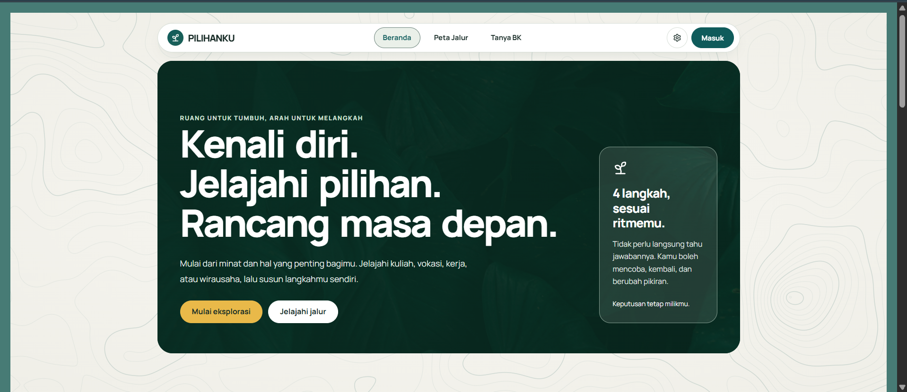
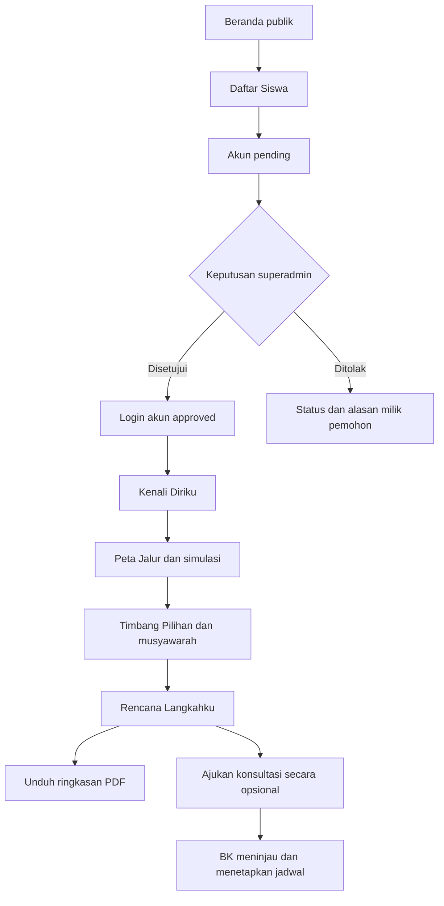
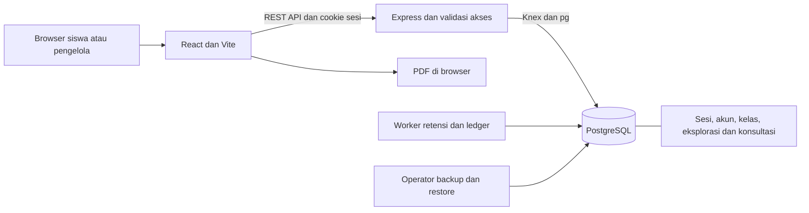

<p align="center">
  
</p>

<h1 align="center">PILIHANKU</h1>

<p align="center">
  <strong>Kenali diri. Jelajahi pilihan. Rancang masa depan.</strong><br />
  Platform eksplorasi karier untuk siswa SMA kelas XI–XII,<br />
  dengan perencanaan langkah, musyawarah keluarga, dan pendampingan Guru BK.
</p>

<p align="center">
  <a href="#menjalankan-lokal">Jalankan Lokal</a> ·
  <a href="./docs/VERCEL-DEPLOY.md">Panduan Deploy</a> ·
  <a href="./docs/LOGIN-ACCESS.md">Alur Akses Akun</a> ·
  <a href="./docs/OPERASIONAL.md">Runbook Operator</a>
</p>

<p align="center">
  
  
  
  
  
  
  
</p>

> **Status proyek:** aplikasi lokal sudah diimplementasikan. Penggunaan oleh sekolah masih membutuhkan konten terverifikasi, telaah ahli, persetujuan yang diperlukan, uji pengguna, serta verifikasi lingkungan produksi. Lihat [status dan batas verifikasi](#status-dan-batas-verifikasi).

---

## Navigasi Dokumentasi

1. [Tentang PILIHANKU](#tentang-pilihanku)
2. [Kemampuan Aplikasi](#kemampuan-aplikasi)
3. [Teknologi yang Digunakan](#teknologi-yang-digunakan)
4. [Alur Penggunaan dan Sistem](#alur-penggunaan-dan-sistem)
5. [Susunan Proyek](#susunan-proyek)
6. [Menjalankan Lokal](#menjalankan-lokal)
7. [Konfigurasi Environment](#konfigurasi-environment)
8. [Perintah Pengembangan](#perintah-pengembangan)
9. [Perlindungan Data dan Akses](#perlindungan-data-dan-akses)
10. [Deployment dan Pemeliharaan](#deployment-dan-pemeliharaan)
11. [Status dan Batas Verifikasi](#status-dan-batas-verifikasi)
12. [Dokumen Pendukung](#dokumen-pendukung)

---

## Tentang PILIHANKU

**PILIHANKU** membantu siswa mengenali minat, memahami berbagai jalur setelah SMA, menimbang pilihan, dan menyusun tindakan yang dapat dibawa ke diskusi keluarga atau konsultasi Guru BK.

Pengalaman siswa disusun dalam empat langkah:

| Langkah | Pertanyaan utama | Hasil yang disiapkan |
| --- | --- | --- |
| **01 · Kenali Diriku** | Apa minat dan hal yang penting bagiku? | Refleksi minat RIASEC, nilai pribadi, serta dukungan dan hambatan |
| **02 · Peta Jalur** | Jalur apa saja yang dapat aku jelajahi? | Informasi jalur dan simulasi alternatif |
| **03 · Timbang Pilihan** | Bagaimana membandingkan beberapa opsi? | Matriks pertimbangan berbobot dan lembar musyawarah |
| **04 · Rencana Langkahku** | Apa yang bisa aku lakukan berikutnya? | Pilihan sementara, tugas bertenggat, dan ringkasan PDF |

Empat kelompok jalur disajikan setara: **Kuliah**, **Vokasi & Kedinasan**, **Kerja & Pelatihan**, serta **Wirausaha**. Siswa dapat kembali dan merevisi langkah tanpa harus menyelesaikannya secara berurutan.

Identitas visual memakai hijau gelap, latar putih hangat dengan motif topografi, aksen kuning, tipografi Manrope, navigasi pil, dan kartu membulat. Tampilan desktop/mobile berangkat dari ekspor Stitch; kode referensi asli dipertahankan pada folder sumber lokal.

> Hasil di PILIHANKU adalah bahan refleksi. Aplikasi tidak memberikan diagnosis, peringkat siswa, atau keputusan jurusan dan pekerjaan secara otomatis.

## Kemampuan Aplikasi

### Eksplorasi siswa

- **Refleksi 24 pernyataan:** enam dimensi RIASEC dengan skor mentah, penanganan skor seri, serta bagian nilai dan kondisi yang opsional.
- **Peta jalur interaktif:** pencarian, filter kategori/minat, pagination, sumber informasi, tanggal verifikasi, dan detail dalam panel.
- **Lima tema simulasi:** tidak lolos jalur prestasi, keterbatasan biaya, kerja sambil kuliah, perbedaan pilihan keluarga, dan merintis usaha.
- **Perbandingan 2–3 opsi:** bobot kriteria 1–3 dan penilaian 1–4. Total ditahan saat data belum lengkap; siswa tetap menentukan pilihannya sendiri.
- **Musyawarah keluarga:** mencatat alasan, kesepakatan, perbedaan pandangan, dan dukungan yang dibutuhkan.
- **Rencana tindakan:** tambah, ubah, centang, dan hapus tugas beserta tenggat; pilihan utama/cadangan dapat direvisi.
- **Ekspor terpilih:** pratinjau cakupan, PDF multipage, dan cetak dengan bagian pribadi yang dipilih siswa.

### Akun dan dashboard sesuai peran

| Role | Fokus pekerjaan | Batas akses |
| --- | --- | --- |
| **Superadmin** | Meninjau dan menyetujui/menolak pendaftaran siswa, mengelola akun BK, kelas, penugasan, dan informasi layanan | Administrasi akun tidak membuka seluruh refleksi atau konsultasi privat |
| **BK** | Menindaklanjuti konsultasi, menetapkan jadwal, melihat agregat aman, dan memperbarui bank informasi | Hanya kelas berwenang serta bagian yang sengaja dibagikan siswa; tidak dapat menyetujui pendaftaran |
| **Siswa** | Mengisi refleksi, menjelajahi jalur, membandingkan, menyusun rencana, dan meminta konsultasi | Akun harus `approved`; data pribadi hanya milik sendiri |

Pendaftaran publik selalu menghasilkan **`siswa/pending`**. Hanya superadmin dapat menyetujui atau menolak. Akun BK dibuat superadmin; tidak ada pendaftaran umum untuk BK atau superadmin.

### Konsultasi dan pengelolaan informasi

Tanya BK tersedia melalui panel global, termasuk sebelum siswa mengisi rencana. Siswa memilih bagian yang akan dibagikan, meninjau penerima dan pesan, lalu mengirim permintaan. Seluruh pilihan berbagi awalnya kosong.

BK meninjau permintaan dan menentukan jadwal dengan zona waktu sekolah. Siswa dapat memantau status, membatalkan permintaan aktif, atau menarik bagian yang dibagikan. **Preferensi waktu bukan konfirmasi jadwal**, dan formulir ini bukan live chat atau layanan darurat.

Bank informasi mendukung draf, pratinjau, pemeriksaan sumber, penerbitan, pelaporan tautan, dan arsip. Sumber HTTPS, tanggal verifikasi, serta konfirmasi pemeriksa dibutuhkan untuk menerbitkan kartu; pemeriksaan isi tetap menjadi tanggung jawab manusia.

## Teknologi yang Digunakan

| Bagian | Teknologi | Fungsi |
| --- | --- | --- |
| Bahasa | JavaScript ES Modules / JSX | Kode frontend dan backend |
| Frontend | React 19, Vite 8, React Router 7 | Delapan layout responsif, navigasi, dan panel |
| Styling | Tailwind CSS 4, CSS variables, Manrope | Sistem visual dan komponen bersama |
| Ikon dan animasi | Lucide React, GSAP, Motion | Ikon, transisi, dan interaksi visual |
| API | Node.js 24, Express 5, Zod | Routing, validasi, dan aturan layanan |
| Database | PostgreSQL, Knex 3, `pg` | Migration, constraint, query, dan transaksi |
| Autentikasi | `express-session`, `connect-pg-simple`, Argon2id | Sesi server-side dan hash password |
| Proteksi HTTP | Helmet, CSRF/Origin, rate limit PostgreSQL | Header keamanan dan pembatasan request |
| Dokumen | jsPDF, jsPDF-AutoTable | Ringkasan PDF yang diproses di browser |
| Pengujian | Node test runner, Supertest, ESLint | Pengujian domain/API serta pemeriksaan kode |

Versi paket persis mengikuti `package-lock.json` pada masing-masing aplikasi. Gunakan Node.js **24.x**, sesuai `engines` di kedua `package.json` dan `.nvmrc`.

## Alur Penggunaan dan Sistem

### Dari pendaftaran sampai eksplorasi



Diagram menunjukkan urutan panduan; empat langkah tetap dapat dibuka bebas. Konsultasi tidak mensyaratkan rencana lengkap. Status pengiriman, penyimpanan, dan persetujuan berasal dari hasil server, bukan perubahan tampilan semata.

### Pemisahan frontend, backend, dan data



**Akses saat ini:** beranda, Masuk, Daftar Siswa, pemeriksaan status dengan verifikasi kredensial, dan informasi privasi tersedia tanpa sesi. **Seluruh fitur aplikasi membutuhkan login akun approved.** Mode Tamu, impor draf tamu, konsultasi token tamu, serta ekspor tanpa sesi pada rancangan awal sudah dinonaktifkan. Rincian dan riwayat perubahan ada pada [LOGIN-ACCESS](docs/LOGIN-ACCESS.md).

## Susunan Proyek

```text
PILIHANKU/
|-- backend/
|   |-- src/
|   |   |-- config/                 # Environment, database, guard produksi
|   |   |-- database/migrations/    # Schema dan indeks berversi
|   |   |-- middleware/             # Sesi, role, CSRF, validasi, rate limit
|   |   |-- modules/                # Auth, approval, kelas, eksplorasi, konten, BK
|   |   |-- operations/             # Health, ledger, backup dan lifecycle
|   |   |-- jobs/                   # Retensi dan penghapusan
|   |   |-- scripts/                # Bootstrap, database lokal, worker, operasi
|   |   |-- app.js
|   |   `-- server.js
|   |-- tests/
|   |-- .env.example
|   `-- package.json
|-- frontend/
|   |-- public/                    # Aset publik, manifest dan service worker
|   |-- src/
|   |   |-- pages/                 # Delapan layout utama L01-L08
|   |   |-- components/            # UI dan navigasi bersama
|   |   |-- context/               # Sesi dan eksplorasi akun
|   |   |-- features/              # Konsultasi, ekspor dan privasi
|   |   |-- exports/               # Generasi PDF
|   |   |-- services/              # Fetch API, CSRF dan invalidasi respons
|   |   |-- styles/                # Token, tampilan, dan cetak
|   |   `-- data/                  # Materi berversi
|   |-- tests/
|   |-- vite.config.js
|   `-- package.json
|-- api/index.mjs                  # Adapter Express untuk konfigurasi serverless
|-- deploy/nginx.conf.example      # Contoh reverse proxy
|-- docs/                          # Panduan, laporan dan screenshot
|-- Dockerfile
|-- vercel.json
|-- PRD.md
|-- design.md
|-- structure.md
|-- TASKLIST.md
`-- README.md
```

Sumber UI Stitch tersedia pada workspace lokal di `stitch_pilihanku_career_platform_ui/` dan diabaikan oleh Git. Folder `.local/`, `.env`, `tmp/`, dan `output/` juga tidak dipublikasikan. Screenshot README disimpan tersendiri di `docs/screenshots/`.

## Menjalankan Lokal

### Prasyarat

- **Node.js 24.x** dan npm.
- **PostgreSQL**, atau gunakan helper database lokal yang tersedia.
- Tiga terminal bila memakai helper database, backend, dan frontend secara bersamaan.

```powershell
git clone https://github.com/tegokkk/PILIHANKU.git
cd PILIHANKU
```

### 1. Jalankan database development

Dari root proyek, pada terminal pertama:

```powershell
cd backend
npm ci
npm run db:local
```

Helper menjalankan PostgreSQL sungguhan melalui `embedded-postgres` pada `127.0.0.1:55432`, menyiapkan `pilihanku` dan `pilihanku_test`, serta membuat kredensial acak di `backend/.local/`. Jika `.env` belum ada, helper membuat konfigurasi development beserta kredensial bootstrap acak; `.env` yang sudah tersedia tidak ditimpa.

Biarkan terminal database berjalan. Helper hanya untuk development, bukan penyimpanan atau backup produksi.

### 2. Siapkan dan jalankan backend

Buka terminal baru dari root proyek:

```powershell
cd backend
npm run migrate
npm run bootstrap
npm run dev
```

`bootstrap` hanya untuk database awal yang belum mempunyai superadmin. Untuk workspace yang sudah diinisialisasi, jalankan migration bila diperlukan dan lewati bootstrap; skrip menolak pembuatan admin awal kedua.

Kredensial lokal mengikuti `BOOTSTRAP_USERNAME` dan `BOOTSTRAP_PASSWORD` di `.env` lokal. Baca melalui editor pribadi dan serahkan melalui saluran aman; jangan membagikan `.env` atau memasukkan nilainya ke repository. Setelah handoff, hapus kredensial bootstrap dari environment operasional.

Login sebagai superadmin untuk membuat kelas, memperoleh kode pendaftaran, membuat akun BK, dan menentukan penugasannya. Kontak serta jam layanan perlu diatur sebelum konsultasi menerima pengiriman.

`seed:demo` bukan bagian setup awal standar: skrip tersebut mensyaratkan sekolah bertanda demo. Bootstrap saat ini membuat sekolah non-demo. Untuk data awal biasa, gunakan pengelolaan kelas di aplikasi; jangan menjalankan fixture/seed demo pada database produksi.

### 3. Jalankan frontend

Buka terminal baru dari root proyek:

```powershell
cd frontend
npm ci
npm run dev
```

| Layanan lokal | Alamat |
| --- | --- |
| Website | [http://localhost:5173](http://localhost:5173) |
| Readiness API dan database | [http://localhost:3001/api/health](http://localhost:3001/api/health) |
| Liveness proses | [http://localhost:3001/api/health/live](http://localhost:3001/api/health/live) |

Proxy Vite meneruskan `/api` ke `127.0.0.1:3001`. Hostname, port frontend, dan `APP_ORIGIN` harus sesuai; perubahan origin memerlukan pembaruan konfigurasi dan restart backend.

<details>
<summary><strong>Alternatif: gunakan PostgreSQL yang dikelola sendiri</strong></summary>

Pada instalasi baru, siapkan database aplikasi dan database test yang terpisah, lalu salin contoh konfigurasi:

```powershell
cd backend
npm ci
Copy-Item .env.example .env
```

Isi `DATABASE_URL`, `TEST_DATABASE_URL`, `APP_ORIGIN`, dan rahasia sesi di `.env`. Nama database test harus berakhiran `_test`. Siapkan `BOOTSTRAP_USERNAME`, `BOOTSTRAP_PASSWORD`, nama sekolah dan zona waktu untuk bootstrap pertama. Jangan menimpa `.env` yang sudah dikonfigurasi.

Untuk membuat rahasia sesi acak:

```powershell
node -e "console.log(require('node:crypto').randomBytes(48).toString('hex'))"
```

Simpan hasilnya sebagai `SESSION_SECRET`, kemudian jalankan migration, bootstrap satu kali, dan backend seperti langkah di atas. Jangan menjalankan helper database bila sudah memakai PostgreSQL sendiri.

</details>

## Konfigurasi Environment

Konfigurasi aplikasi berada di `backend/.env`. Frontend tidak memerlukan rahasia dan menggunakan `/api` pada origin yang sama. Lihat [contoh backend](backend/.env.example) dan [contoh frontend](frontend/.env.example).

| Variabel | Penggunaan |
| --- | --- |
| `NODE_ENV` | `development`, `test`, atau `production` |
| `PORT` | Port Express; default `3001` |
| `BIND_HOST` | Default `127.0.0.1`; `0.0.0.0` untuk container yang dikonfigurasi |
| `APP_ORIGIN` | Origin frontend persis; HTTPS pada produksi |
| `DATABASE_URL` | Koneksi PostgreSQL aplikasi, hanya server |
| `TEST_DATABASE_URL` | Database disposable terpisah dengan nama berakhiran `_test` |
| `SESSION_SECRET` | Minimal 32 karakter acak; jangan memakai nilai placeholder |
| `TRUST_PROXY` | Default `0`; `1` hanya dengan satu reverse proxy tepercaya sesuai deployment |
| `PENDING_RETENTION_DAYS` | Batas pengajuan pending/rejected; 1–365 hari, default usulan `90` |
| `DEMO_CONTENT` | Konten contoh development; `false` atau tidak aktif pada produksi |
| `BOOTSTRAP_USERNAME`, `BOOTSTRAP_PASSWORD` | Hanya untuk admin awal; keluarkan dari runtime produksi |
| `BOOTSTRAP_SCHOOL_NAME`, `BOOTSTRAP_TIMEZONE` | Identitas sekolah awal dan zona waktu IANA |
| `LOG_REQUESTS` | Log metadata tersanitasi; produksi aktif secara default kecuali `false` |
| `DELETION_LEDGER_PATH` | Path absolut ledger terpisah; wajib untuk worker production |
| `PG_BIN` | Direktori alat PostgreSQL untuk backup/restore, atau sediakan melalui PATH |
| `BACKUP_KEY` | Kunci backup 32 byte acak dalam base64; simpan terpisah dari arsip |
| `RESTORE_DATABASE_URL` | Database kosong dan terisolasi untuk pemulihan |

Tidak ada password database, `SESSION_SECRET`, kunci backup, atau kredensial bootstrap yang boleh diekspos melalui awalan `VITE_`, URL, log, dan source control.

## Perintah Pengembangan

### Backend — jalankan dari `backend/`

| Perintah | Kegunaan |
| --- | --- |
| `npm run dev` | Express dengan pemantauan perubahan |
| `npm start` | Menjalankan API; memeriksa kesiapan schema saat startup |
| `npm run db:local` | PostgreSQL development lokal |
| `npm run migrate` | Menjalankan migration yang belum diterapkan |
| `npm run bootstrap` | Membuat superadmin awal satu kali |
| `npm run seed:demo` | Kelas demo; hanya pada lingkungan/sekolah demo yang sesuai |
| `npm run lint` | Pemeriksaan kode backend |
| `npm test` | Pengujian API/domain dengan PostgreSQL test |
| `npm run test:load` | Benchmark pilot pada database test sintetis |
| `npm run retention` | Retensi/penghapusan satu kali |
| `npm run worker` | Worker retensi dan ekspor ledger berkala |
| `npm run backup -- <arsip.enc> <ledger.json>` | Backup terenkripsi dan ledger terpisah |
| `npm run restore -- <arsip.enc> <ledger.json> <nama_database>` | Restore terkendali ke database kosong |

### Frontend — jalankan dari `frontend/`

| Perintah | Kegunaan |
| --- | --- |
| `npm run dev` | Vite development pada localhost:5173 |
| `npm run lint` | Pemeriksaan kode frontend |
| `npm test` | Pengujian domain, akses, render, dan ekspor |
| `npm run build` | Build produksi, precache aset publik, dan service worker |
| `npm run preview` | Pratinjau build lokal; bukan server produksi |

Untuk pemeriksaan utama, jalankan pada masing-masing direktori:

```powershell
npm run lint
npm test
```

Kemudian dari `frontend/`:

```powershell
npm run build
```

Pengujian backend mengosongkan database test. `TEST_DATABASE_URL` harus menunjuk database disposable berakhiran `_test`, bukan database pengguna. Untuk seluruh kasus backup/restore, sediakan alat PostgreSQL melalui `PG_BIN`; kasus yang membutuhkan alat tersebut dapat dilewati jika tidak tersedia. Benchmark dijalankan terpisah sesudah suite, bukan bersamaan memakai database yang sama.

Pada `npm run preview`, sesuaikan `APP_ORIGIN` backend jika menguji sesi melalui port preview. Nomor dan hasil uji historis dicatat pada dokumen verifikasi; README ini tidak memberi jaminan bahwa perubahan kode berikutnya sudah lulus tanpa menjalankan uji ulang.

## Perlindungan Data dan Akses

- **Login approved:** semua fitur, simulasi, ekspor termasuk lembar kosong, serta API aplikasi memerlukan sesi; akun pending/rejected/suspended ditolak.
- **Otorisasi server:** role, sekolah, kelas, kepemilikan dan penugasan diperiksa di backend; menyembunyikan menu tidak memberikan perlindungan akses.
- **Sesi server-side:** PostgreSQL menyimpan sesi, cookie `HttpOnly`, produksi `Secure`, dan `SameSite=Lax`. Batas absolut delapan jam dan idle 30 menit; pemeriksaan pasif tidak memperpanjang idle.
- **Logout dan perubahan akses:** reset/password/status/penugasan mencabut sesi terkait. UI privat dibersihkan, request dibatalkan, dan respons yang terlambat ditolak. Logout yang gagal jaringan tetap mengunci akses lokal sampai pencabutan dapat dicoba kembali.
- **Berbagi terpilih:** snapshot konsultasi hanya berasal dari bagian akun yang dipilih; tidak berubah diam-diam saat refleksi berikutnya diedit. Dokumen yang sudah diunduh penerima tidak dapat ditarik dari perangkatnya oleh sistem.
- **Agregat aman:** hitungan siswa unik, consent terpisah, kelompok 1–4 serta pelengkap yang dapat mengungkapnya disembunyikan dari respons, tooltip dan tampilan.
- **Konten dan cache:** draf tidak masuk katalog; opsi menyimpan versi. Respons API memakai `no-store`, service worker hanya menyimpan shell/aset publik. Shell luring tidak membuka fitur privat tanpa verifikasi sesi.
- **Penghapusan:** siswa approved dapat menghapus data aktif miliknya melalui Pengaturan Data, tanpa persetujuan guru. Penghapusan pendaftaran yang belum aktif ditangani melalui petugas sekolah dengan verifikasi pemilik.

Retensi mengikuti akhir tahun ajaran yang dikonfigurasi serta kebijakan pengajuan. Akses jatuh tempo ditolak meskipun job belum berjalan. Prosedur ledger, retensi audit, backup terenkripsi, dan pemulihan ada pada [runbook operasional](docs/OPERASIONAL.md).

## Deployment dan Pemeliharaan

Repository menyediakan dua jalur konfigurasi:

| Jalur | Berkas/panduan | Catatan |
| --- | --- | --- |
| Node.js / container dengan reverse proxy | [Dockerfile](Dockerfile), [contoh Nginx](deploy/nginx.conf.example) | Express produksi menyajikan `frontend/dist/` dan `/api` pada satu origin |
| Adapter serverless dan frontend statis | [vercel.json](vercel.json), [api/index.mjs](api/index.mjs), [panduan deploy manual](docs/VERCEL-DEPLOY.md) | Gunakan konfigurasi root repository; job pemeliharaan tetap perlu penjadwal yang sesuai |

Konfigurasi di repository bukan bukti deployment sudah berlangsung. Tidak ada URL demo produksi yang diasumsikan aktif di README ini.

Urutan persiapan:

1. Tetapkan operator, domain, penyedia, PostgreSQL dan kebijakan sekolah.
2. Pasang dependensi dari lockfile, build frontend, dan jalankan migration pada database tujuan.
3. Bootstrap admin pertama secara aman, kemudian keluarkan kredensial bootstrap dari runtime.
4. Atur origin HTTPS, proxy/cookie, kelas, penugasan BK, kontak dan jam layanan.
5. Pasang penjadwal retensi, ledger independen, backup terenkripsi dan monitoring.
6. Lakukan smoke test browser sampai database: login role, approval, simpan/reload, konsultasi, PDF, logout dan penghapusan.

Runtime production menolak `DEMO_CONTENT=true`, sekolah demo, kredensial bootstrap yang masih terpasang, serta schema yang belum lengkap. Jangan menjalankan seed atau fixture QA pada database sekolah.

Health tersedia pada `/api/health/live` untuk proses dan `/api/health` untuk database/tabel sesi/limiter. Metadata operasi tersedia pada `/api/admin/operations` khusus superadmin. Pemantauan, worker, backup harian, restore terisolasi, dan rekonsiliasi perubahan akses dijelaskan di [OPERASIONAL.md](docs/OPERASIONAL.md).

Sebelum membuka trafik dari hasil pemulihan, terapkan ledger penghapusan terbaru, retensi, serta rekonsiliasi reset/suspend sejak snapshot. Cadangan harus mempunyai masa simpan sesuai kebijakan, dengan target maksimal 30 hari pada rancangan produk. Contoh Docker/proxy dan integrasi hosting perlu diuji pada lingkungan tujuan; jangan menyamakan pengujian lokal dengan verifikasi hosting.

## Status dan Batas Verifikasi

| Area | Kondisi dokumentasi saat ini |
| --- | --- |
| Aplikasi lokal | Frontend, API, database, login/approval dan alur siswa/BK sudah diimplementasikan |
| Pengujian teknis | Rekaman API/domain/browser, build, akses, perbaikan temuan dan batas pengukuran tersedia di dokumen laporan |
| Konten | 24 butir dan lima skenario masih membutuhkan telaah ahli; 10 kartu contoh belum menjadi 40 kartu resmi terverifikasi |
| Uji pengguna | Persetujuan, uji 6–10 siswa dan BK, keterpahaman, serta SUS memerlukan pelaksanaan dan bukti manusia |
| Lingkungan operasional | Hosting, HTTPS/cookie, scheduler, backup penyedia dan smoke test harus diverifikasi operator pada targetnya |

**Catatan pembaruan 22 November 2026:** akses fitur diwajibkan login approved; beranda pengenalan tetap publik. Migration `005_rate_limits` pada development lokal sudah ditangani dalam pekerjaan sebelumnya untuk memperbaiki error `/api/auth/me`; instalasi lain tetap harus menjalankan `npm run migrate`. Riwayat remediasi mencakup pembatasan request PostgreSQL, retensi/ledger, backup/restore, dan pemeriksaan tampilan/aksesibilitas/PDF pada cakupan yang dicatat.

Untuk hasil dan bukti yang tepat, baca [akses login](docs/LOGIN-ACCESS.md), [hasil remediasi](docs/REMEDIATION-2026-11-22.md), [audit awal](docs/PRODUCTION-AUDIT-2026-11-22.md), dan [verifikasi implementasi](docs/VERIFICATION.md). Catatan pengujian lama yang memakai Mode Tamu bersifat historis; gunakan aturan akses terbaru.

Belum ada klaim bahwa telaah ahli, sumber konten resmi, persetujuan sekolah/wali, SUS, kapasitas hosting, atau efektivitas keputusan karier sudah lulus hanya karena kode dan tampilan tersedia. Form pencatatannya disiapkan pada [VALIDASI-SEKOLAH.md](docs/VALIDASI-SEKOLAH.md).

## Dokumen Pendukung

| Dokumen | Isi |
| --- | --- |
| [PRD.md](PRD.md) | Tujuan, aturan produk, kebutuhan fitur dan kriteria penerimaan |
| [design.md](design.md) | Sistem visual, delapan layout dan referensi UI |
| [structure.md](structure.md) | Stack, modul, struktur frontend/backend, serta kontrak akun |
| [TASKLIST.md](TASKLIST.md) | Pekerjaan dan status implementasi; perhatikan catatan perubahan akses terbaru |
| [LOGIN-ACCESS.md](docs/LOGIN-ACCESS.md) | Gerbang sesi, role, logout, ekspor dan cakupan akses publik |
| [VERCEL-DEPLOY.md](docs/VERCEL-DEPLOY.md) | Konfigurasi deploy manual adapter yang tersedia |
| [OPERASIONAL.md](docs/OPERASIONAL.md) | Health, worker, log, backup/restore, ledger dan pemulihan |
| [ASSETS.md](docs/ASSETS.md) | Sumber aset dan catatan hak penggunaan |
| [VALIDASI-SEKOLAH.md](docs/VALIDASI-SEKOLAH.md) | Materi/protokol dan lembar keputusan ahli/sekolah |
| [REMEDIATION-2026-11-22.md](docs/REMEDIATION-2026-11-22.md) | Hasil perbaikan teknis, verifikasi dan pekerjaan eksternal yang tersisa |
| [VERIFICATION.md](docs/VERIFICATION.md) | Jejak pengujian implementasi beserta batasnya |

---

<p align="center">
  <strong>PILIHANKU</strong><br />
  Ruang untuk tumbuh, arah untuk melangkah.<br />
  <sub>Keputusan tetap milik siswa, dengan dukungan keluarga dan Guru BK.</sub>
</p>

Format penyajian dokumentasi diadaptasi dari [PHOTOBOOTH1](https://github.com/tegokkk/PHOTOBOOTH1). Screenshot pembuka berasal dari tampilan PILIHANKU yang diberikan pemilik proyek.
